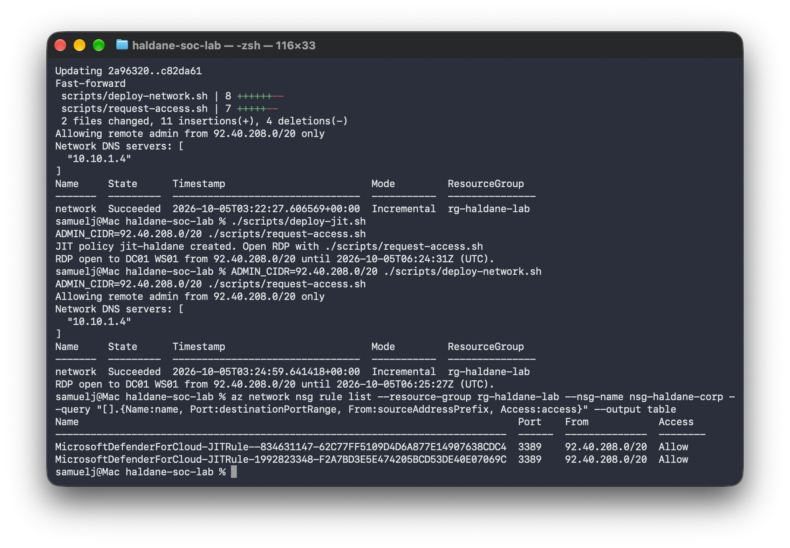
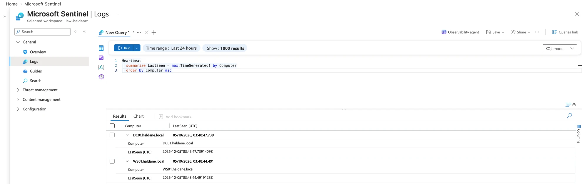

# Phase 2: Visibility

> **In progress.** Done so far: the SIEM, Defender for Servers and
> Just-in-Time access. Next: Sysmon and connecting the log sources.

## What was built

| Component | Purpose | Built from |
| --- | --- | --- |
| Log Analytics workspace `law-haldane` | Stores every log; searched with KQL. 1 GB/day cap, 30-day retention. | [`infra/monitoring.bicep`](../infra/monitoring.bicep) |
| Microsoft Sentinel | SIEM on top of the workspace: analytics rules, incidents, workbooks, automation | [`infra/monitoring.bicep`](../infra/monitoring.bicep) |
| Defender for Servers Plan 2 | Installs Microsoft Defender for Endpoint (EDR) on both VMs; enables Just-in-Time access | `az security pricing create` (30-day trial) |
| Just-in-Time (JIT) VM access | RDP is closed by default and opened for up to 3 hours on request | [`infra/jit.bicep`](../infra/jit.bicep), [`scripts/request-access.sh`](../scripts/request-access.sh) |

WS01 was also moved from the default `Computers` container into
`Haldane\Servers` ([`05-move-ws01.ps1`](../scripts/windows/05-move-ws01.ps1)).

## Remote access: from a permanent rule to Just-in-Time

| | Before | After |
| --- | --- | --- |
| RDP reachable when the lab isn't in use | Yes, 24/7 from the admin's address | No |
| How access is granted | Permanent NSG rule | `request-access.sh` adds a temporary NSG rule for up to 3 hours |
| Evidence | | NSG shows only `MicrosoftDefenderForCloud-JITRule-*` rules while a request is active; Azure's default `DenyAllInBound` blocks everything else |

Deploying JIT, closing the permanent rule and requesting access, then
listing the corp NSG's rules: only the two temporary JIT rules remain.

## Proving each log source arrives

Each source is checked with a query from [`queries/data-health.kql`](../queries/data-health.kql)
in Sentinel's Logs page.

**1. Heartbeat:** the Azure Monitor Agent on both VMs is alive and reporting.

## Problems and fixes

| Problem | Cause | Fix |
| --- | --- | --- |
| Sentinel onboarding failed with `MissingSubscriptionRegistration` | New subscriptions don't have most Azure services ("resource providers") registered | `deploy-monitoring.sh` now registers the five providers Sentinel needs before deploying |
| Creating the JIT policy failed with `PolicyNotFound` | Run seconds after enabling Defender for Servers, before the JIT feature was available | Waited about 15 minutes and re-ran; `request-access.sh` now finds the policy by lookup rather than by name |
| RDP kept disconnecting, and reconnecting failed | On a mobile connection the public IP changed three times in one session (92.40.216.17, then .214.35, then .214.34), so a single-IP rule was always out of date | Allowed the provider's /20 block instead (`ADMIN_CIDR`), a deliberate trade-off between security and usability |
| Sysmon installed without a configuration ("Failed to open xml configuration") | The sysmon-modular config URL returned 404: the upstream project had moved its files, and the download failure wasn't reported | Switched to SwiftOnSecurity's sysmon-config and made the script stop on the first error |
| Mac commands typed into the VM's PowerShell | Two terminals open at once | Check the prompt: `%` is the Mac, `PS C:\>` is Windows |

## Still to do

- Confirm both VMs appear in Defender for Endpoint (security.microsoft.com, Assets, Devices).
- Install Sysmon on DC01 and WS01.
- Connect the log sources to Sentinel and prove each one arrives with a KQL query.
- Decide before day 30 of the trial whether to keep Defender for Servers.
