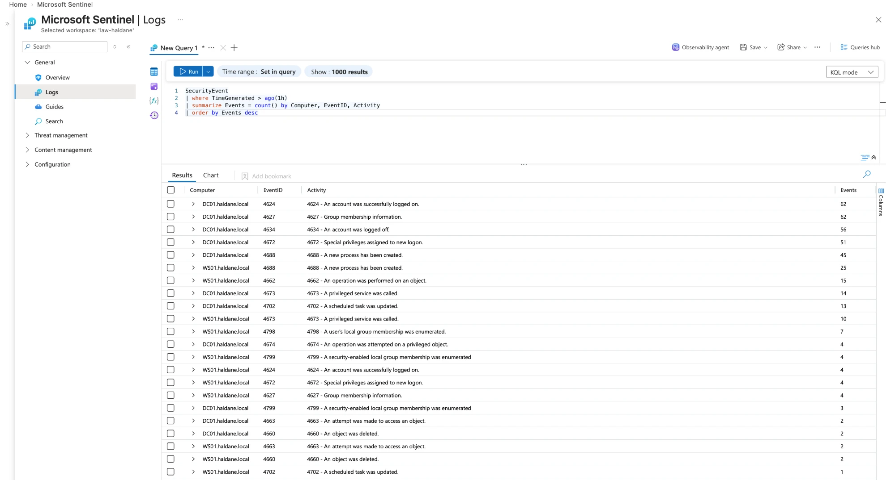
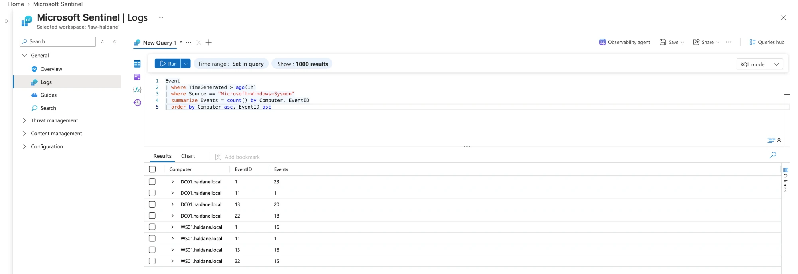
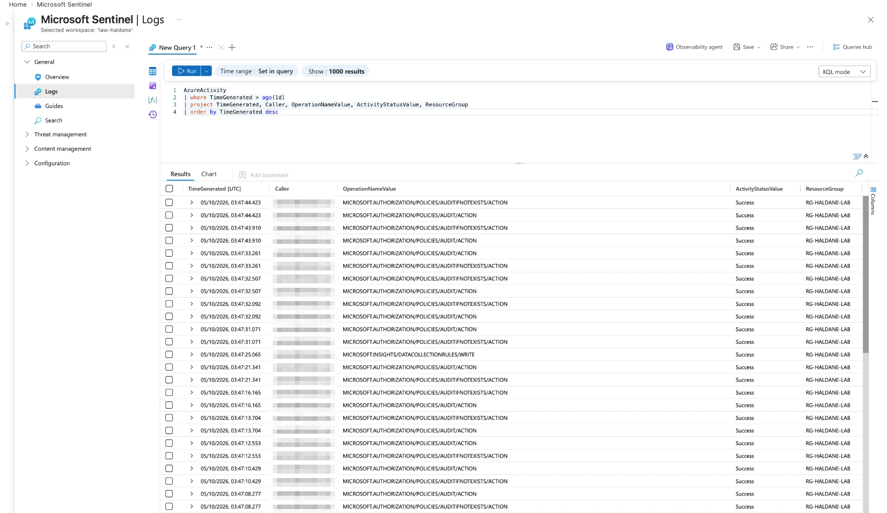
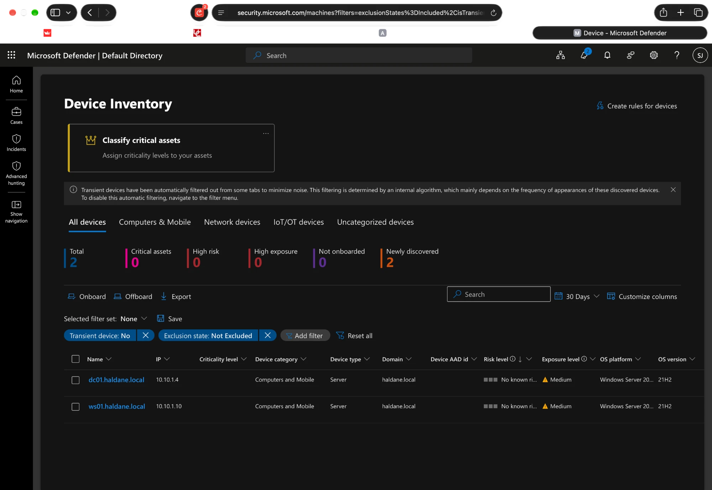
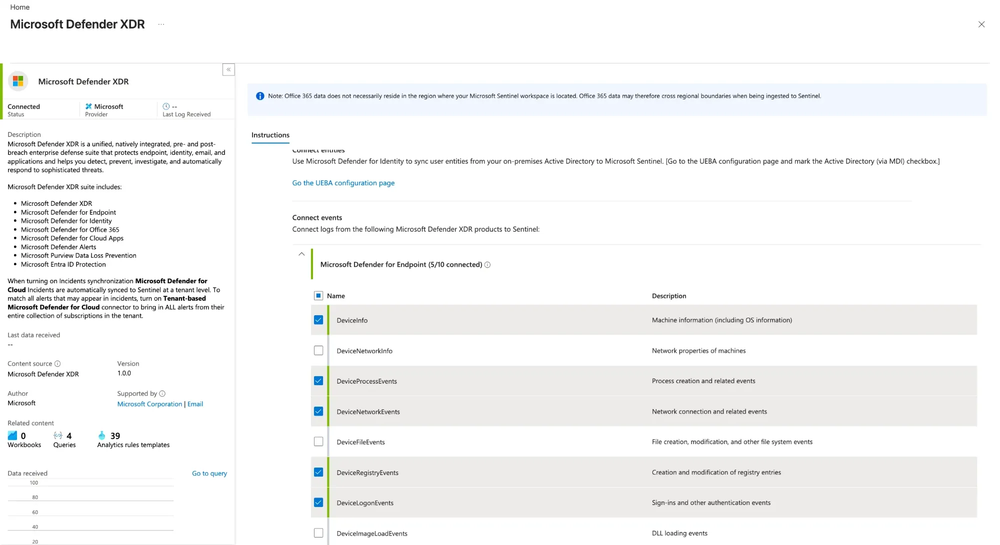
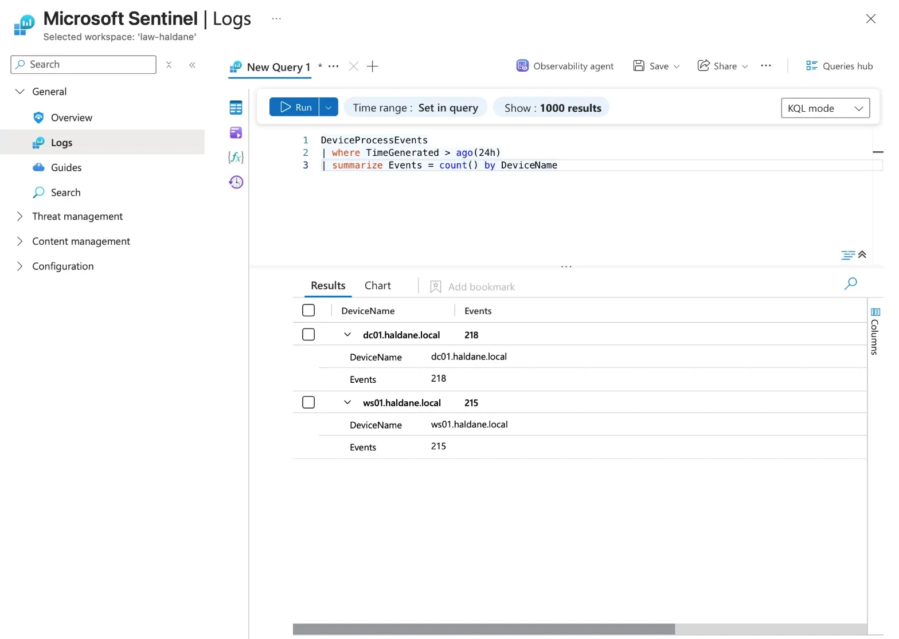

# Phase 2: Visibility

> **Done.** The SIEM, Defender for Servers (with Defender for Endpoint on both
> VMs), Just-in-Time access, Sysmon, and five log sources proven in Sentinel:
> Heartbeat, Windows Security events, Sysmon, Azure Activity and Defender for
> Endpoint.

## What was built

| Component | Purpose | Built from |
| --- | --- | --- |
| Log Analytics workspace `law-haldane` | Stores every log; searched with KQL. 1 GB/day cap, 30-day retention. | [`infra/monitoring.bicep`](../infra/monitoring.bicep) |
| Microsoft Sentinel | SIEM on top of the workspace: analytics rules, incidents, workbooks, automation | [`infra/monitoring.bicep`](../infra/monitoring.bicep) |
| Defender for Servers Plan 2 | Installs Microsoft Defender for Endpoint (EDR) on both VMs; enables Just-in-Time access | `az security pricing create` (30-day trial) |
| Sysmon (SwiftOnSecurity config) | Detailed process, file, registry and DNS activity on both VMs | [`scripts/install-sysmon.sh`](../scripts/install-sysmon.sh) (Azure Run Command, no RDP) |
| Azure Monitor Agent + data collection rule | Sends Security and Sysmon logs to the workspace | [`infra/data-collection.bicep`](../infra/data-collection.bicep) |
| Activity log diagnostic setting | Sends the subscription's Azure Activity log to the workspace | [`infra/activity-log.bicep`](../infra/activity-log.bicep) |
| Just-in-Time (JIT) VM access | RDP is closed by default and opened for up to 3 hours on request | [`infra/jit.bicep`](../infra/jit.bicep), [`scripts/request-access.sh`](../scripts/request-access.sh) |

WS01 was also moved from the default `Computers` container into
`Haldane\Servers` ([`05-move-ws01.ps1`](../scripts/windows/05-move-ws01.ps1)).

## Remote access: from a permanent rule to Just-in-Time

| | Before | After |
| --- | --- | --- |
| RDP reachable when the lab isn't in use | Yes, 24/7 from the admin's address | No |
| How access is granted | Permanent NSG rule | `request-access.sh` adds a temporary NSG rule for up to 3 hours |
| Evidence | | NSG shows only `MicrosoftDefenderForCloud-JITRule-*` rules while a request is active; Azure's default `DenyAllInBound` blocks everything else |

Deploying JIT, closing the permanent rule and requesting access, then
listing the corp NSG's rules: only the two temporary JIT rules remain.

## Proving each log source arrives

Each source is checked with a query from [`queries/data-health.kql`](../queries/data-health.kql)
in Sentinel's Logs page.

**1. Heartbeat:** the Azure Monitor Agent on both VMs is alive and reporting.

**2. SecurityEvent:** Windows Security logs from both machines, including
successful logons (4624), privileged logons (4672), logoffs (4634) and new
processes (4688).

**3. Sysmon:** detailed activity from both machines: processes created (1),
files created (11), registry values set (13) and DNS queries (22). Network
connections (3) are rare because the configuration only records them for
processes worth watching, which keeps the volume down.

**4. AzureActivity:** management actions in the subscription, including the
deployment of the data collection rule (`DATACOLLECTIONRULES/WRITE`). Most
rows are Azure Policy audit checks (`POLICIES/AUDIT...`) triggered by each
change: routine background activity that a real SOC would filter out. (Caller
column blurred.)

**5. Defender for Endpoint:** both VMs onboarded to MDE automatically by
Defender for Servers Plan 2, with no agent installed by hand. Each shows its
domain (`haldane.local`), OS and an exposure level from Defender's own
vulnerability assessment.

**6. Defender XDR connector:** streams Defender's incidents and alerts, plus
five Defender for Endpoint tables, into Sentinel. Only the tables the KQL
detections use were chosen (DeviceInfo, DeviceProcessEvents,
DeviceNetworkEvents, DeviceRegistryEvents, DeviceLogonEvents). The other five,
including the high-volume DeviceFileEvents and DeviceImageLoadEvents, were left
off to stay under the 1 GB/day cap. (Browser bar cropped out.)

**7. DeviceProcessEvents:** Defender for Endpoint process telemetry from both
VMs, queried in the Sentinel workspace itself (not Defender's Advanced hunting,
which would show the data even without the connector). This proves the
connector delivers EDR data into the SIEM, where the detection rules in later
phases will run.

## Problems and fixes

| Problem | Cause | Fix |
| --- | --- | --- |
| Sentinel onboarding failed with `MissingSubscriptionRegistration` | New subscriptions don't have most Azure services ("resource providers") registered | `deploy-monitoring.sh` now registers the five providers Sentinel needs before deploying |
| Creating the JIT policy failed with `PolicyNotFound` | Run seconds after enabling Defender for Servers, before the JIT feature was available | Waited about 15 minutes and re-ran; `request-access.sh` now finds the policy by lookup rather than by name |
| RDP kept disconnecting, and reconnecting failed | On a mobile connection the public IP changed three times in one session (92.40.216.17, then .214.35, then .214.34), so a single-IP rule was always out of date | Allowed the provider's /20 block instead (`ADMIN_CIDR`), a deliberate trade-off between security and usability |
| Sysmon installed without a configuration ("Failed to open xml configuration") | The sysmon-modular config URL returned 404: the upstream project had moved its files, and the download failure wasn't reported | Switched to SwiftOnSecurity's sysmon-config and made the script stop on the first error |
| Mac commands typed into the VM's PowerShell | Two terminals open at once | Check the prompt: `%` is the Mac, `PS C:\>` is Windows |
| Defender portal kept asking to sign in again (`AADSTS50058`) and the sign-in window opened blank | Safari's cross-site tracking protection blocks the background sign-in Microsoft's portals rely on | Used Chrome for the Microsoft portals |

## Decisions

- **Entra ID sign-in logs: skipped on purpose.** Haldane's users live in the
  on-premises Active Directory (`haldane.local`), not in Entra ID, so Entra
  sign-in logs would only show the lab owner signing in to Azure. Their logons
  are already captured by Windows Security events (4624, 4625, 4672) and
  `DeviceLogonEvents`. Collecting Entra sign-in logs would also need an Entra
  ID P1/P2 licence.
- **Defender for Endpoint tables: 5 of 10.** Only the tables the detections
  use, to stay within the 1 GB/day cap (see evidence 6).
- **Defender for Servers trial:** the 30-day trial ends around 4 November
  2026. The purple-team exercise (Phase 6) relies on Defender for Endpoint, so
  it must run before then; the plan can then be switched off to avoid charges.
