# Phase 3: Vulnerability management

> **In progress.** Done so far: the Kali scanner VM (SSH by Just-in-Time
> access only), Nessus Essentials, a dedicated scan account, and the first
> (uncredentialed) scan. Next: the credentialed scan, a comparison of the two,
> and a prioritised findings report.

## What was built

| Component | Purpose | Built from |
| --- | --- | --- |
| KALI01 (10.10.2.4) | Kali Linux in the attacker subnet: runs Nessus and, later, attack simulations against the lab | [`infra/attacker.bicep`](../infra/attacker.bicep), [`scripts/deploy-attacker.sh`](../scripts/deploy-attacker.sh) |
| SSH key sign-in | Kali accepts only the key created on the admin's Mac; password sign-in is switched off | `ssh-keygen` in `deploy-attacker.sh` |
| Just-in-Time SSH | Port 22 is closed until requested, like RDP to the servers; the permanent SSH rule was removed | [`infra/jit.bicep`](../infra/jit.bicep), [`infra/network.bicep`](../infra/network.bicep) |
| SSH tunnel for Nessus | The Nessus web interface (port 8834) is never exposed to the internet; it is reached at `https://localhost:8834` through SSH | [`scripts/connect.sh`](../scripts/connect.sh) |
| Scan account `svc-nessus` | Lets Nessus sign in to DC01 and WS01 for a credentialed scan | [`07-create-scan-account.ps1`](../scripts/windows/07-create-scan-account.ps1) |
| Nessus Essentials | Vulnerability scanner (Tenable), the same product family used in the internship | [`scripts/install-nessus.sh`](../scripts/install-nessus.sh) |

Kali runs in Azure rather than on a local VirtualBox VM because it has to reach
DC01 and WS01 on the lab's private network (10.10.1.0/24).

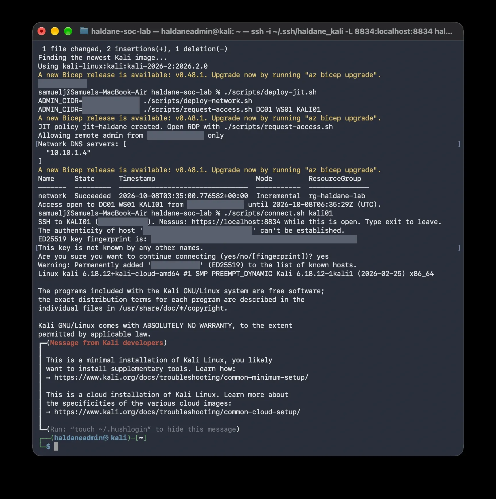

Nessus installed and downloading its plugins (the individual vulnerability
checks) before the first scan, reached through the SSH tunnel at
`https://localhost:8834`. The "Not Secure" warning is expected: Nessus uses a
self-signed certificate, and the traffic is encrypted by SSH anyway.

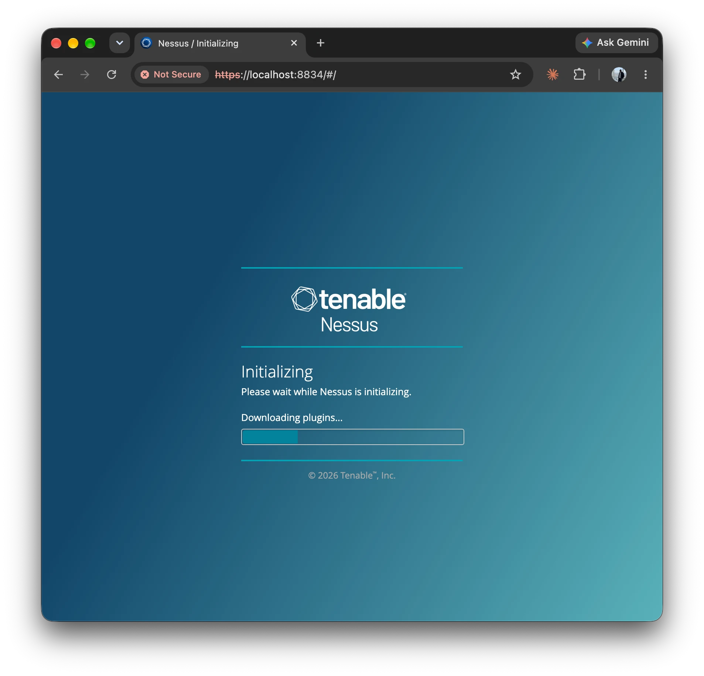

## Two scans, two points of view

| Scan | Signs in? | Sees | Represents |
| --- | --- | --- | --- |
| Uncredentialed | No | Open ports and what services reveal over the network | An attacker already on the network |
| Credentialed | Yes, as `svc-nessus` | Installed software, missing patches, local settings | The organisation's own security team |

Both scan DC01 (10.10.1.4) and WS01 (10.10.1.10) from KALI01 with Nessus's
Basic Network Scan policy.

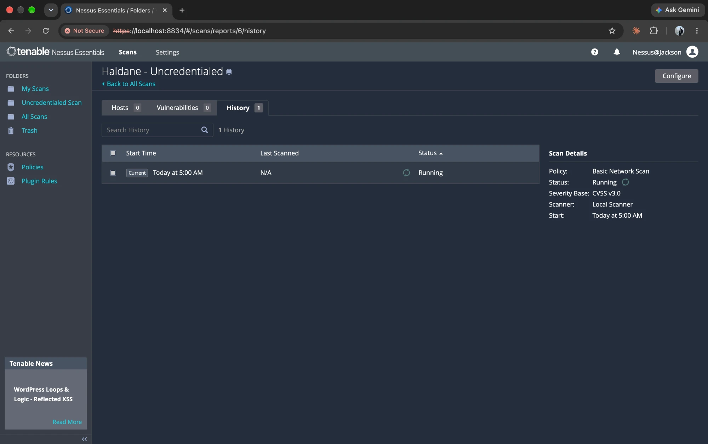

### Scan 1 result: uncredentialed

Completed in 16 minutes: 2 hosts, 31 findings, of which 1 Medium (SMB signing
not required, CVSS 5.3) and 30 informational. Two findings confirm what this
scan could *not* see: "Target Credential Status - No Credentials Provided" and
"OS Security Patch Assessment Not Available". Without signing in, Nessus
cannot check patch levels at all.

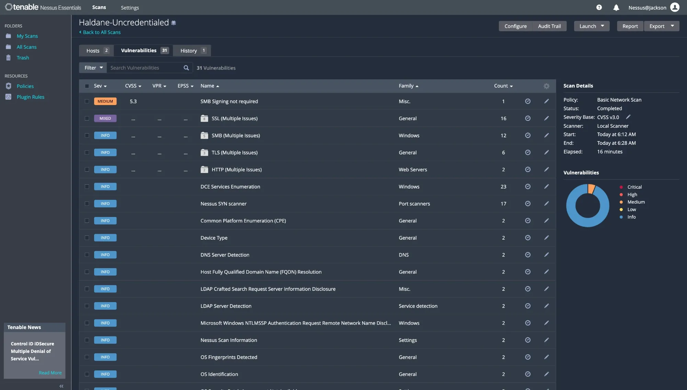
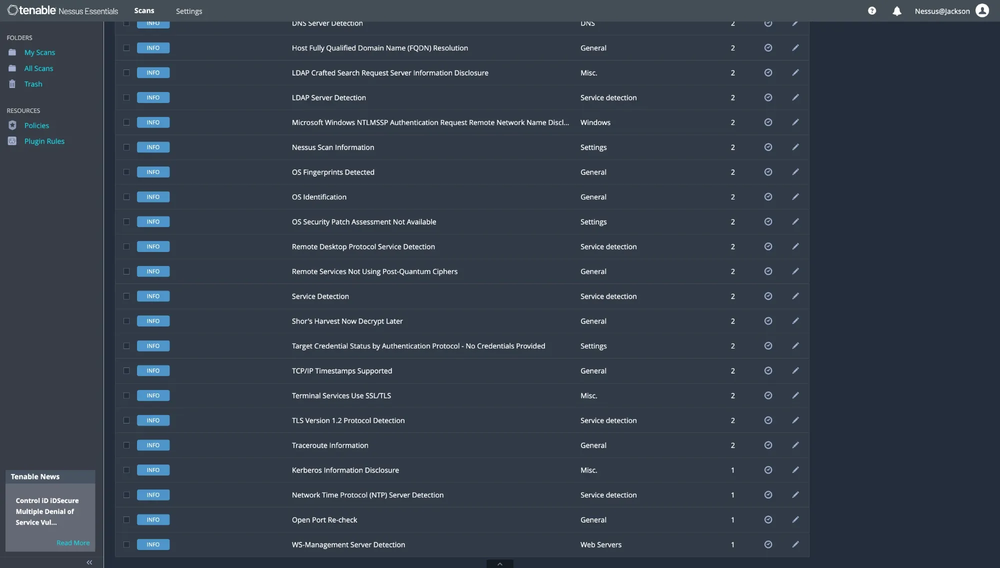

### Scan 2 result: credentialed

Completed in 23 minutes: 2 hosts, 67 findings, including 2 Critical, 1 High
and 1 Medium. Signing in as `svc-nessus` let Nessus check installed software
and Windows settings, which the uncredentialed scan could not see at all.

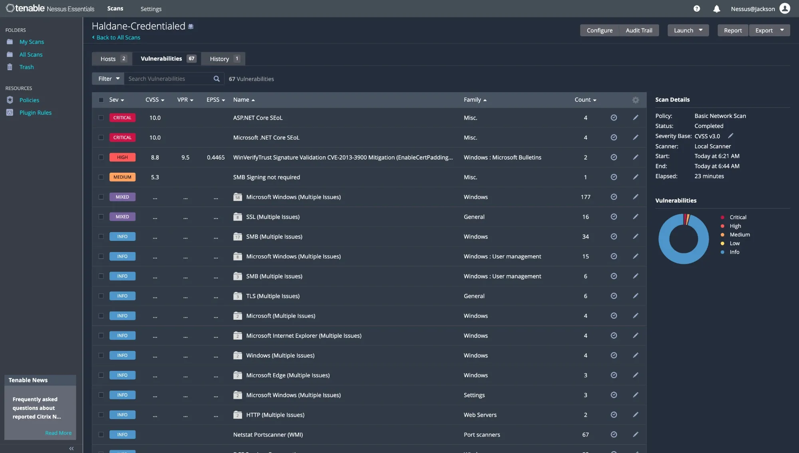
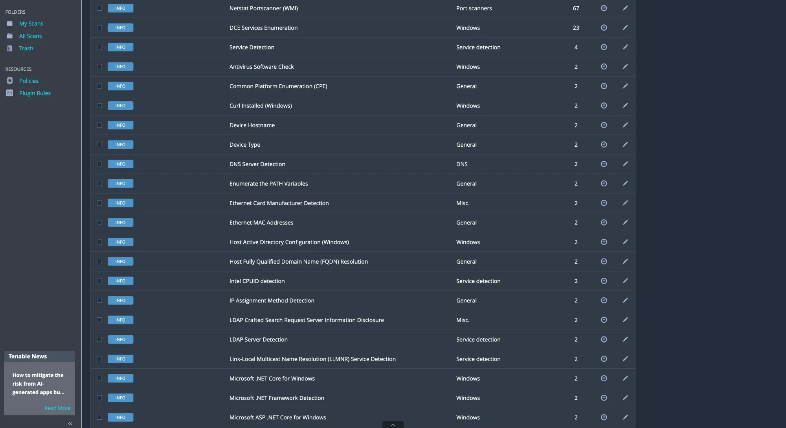
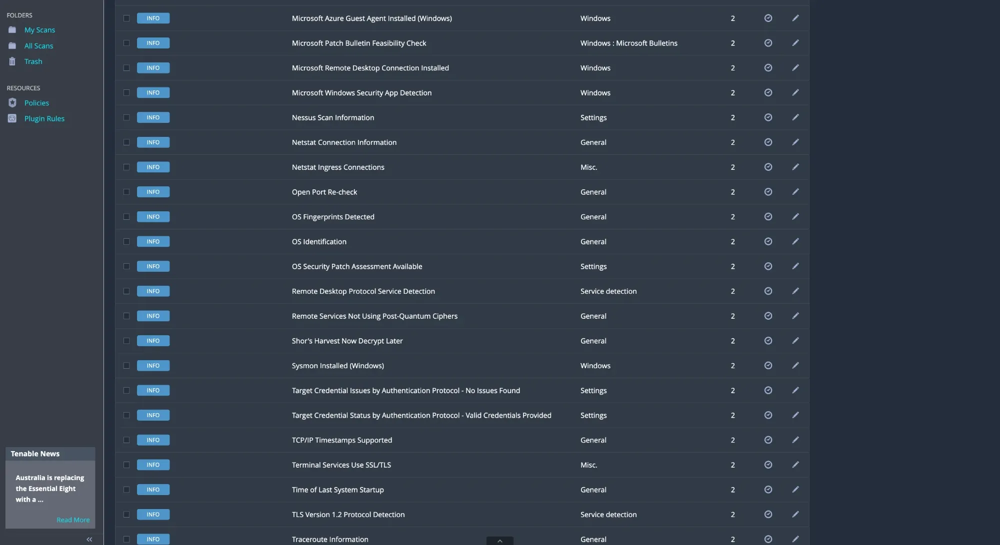
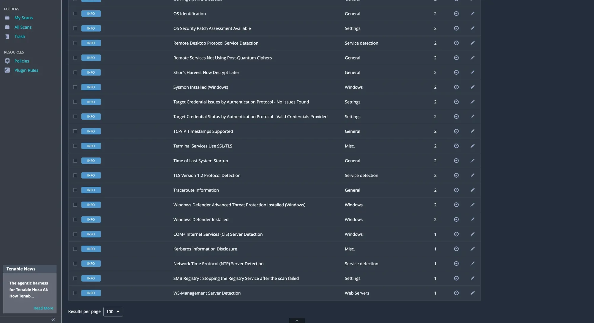

Where Scan 1 reported "No Credentials Provided" and "OS Security Patch
Assessment Not Available", Scan 2 reports "Valid Credentials Provided" and
"OS Security Patch Assessment Available". It also confirms the lab's own
controls from the inside: Sysmon, Microsoft Defender and Defender for Endpoint
are installed on both servers.

One side effect to clean up: "SMB Registry: Stopping the Registry Service
after the scan failed" on one host. Nessus started Remote Registry for the
scan and could not stop it afterwards, so it was left running.

Nessus Essentials does not allow reports or exports, so findings are recorded
from the scan screens.

## What the defenders saw

The credentialed scan behaves like an attacker who has stolen a Domain Admin
password: it signs in to every server over the network. Sentinel recorded all
of it. Windows Security event 4624 (successful logon) shows `svc-nessus`
signing in to each server 1,598 times from 10.10.2.4 (KALI01), as a network
logon (type 3), between 05:23 and 05:44 UTC, matching the scan's run time.

```kql
SecurityEvent
| where TimeGenerated > ago(12h)
| where EventID == 4624 and TargetUserName == "svc-nessus"
| summarize Logons = count(), First = min(TimeGenerated), Last = max(TimeGenerated)
    by Computer, IpAddress, LogonType
```

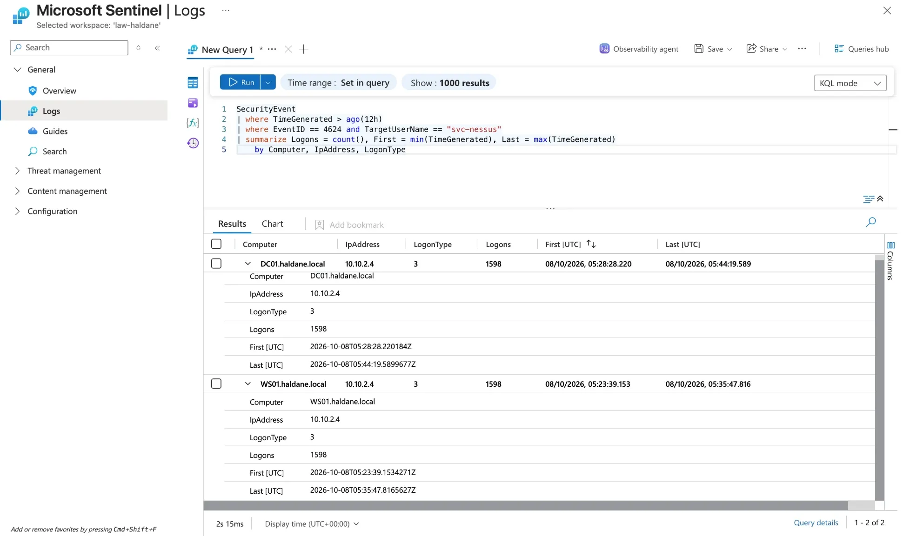

## Decision: one Kali VM for scanning and attack simulation

KALI01 plays two roles: Haldane's vulnerability scanner now (Phase 3), and
the attacker in the purple-team exercise later (Phase 6). Kali is a toolbox;
what makes it "defender" or "attacker" is who uses it and why. A real company
would run its scanner on a dedicated machine in a management network, separate
from any penetration-testing kit. They are combined here to save cost and
quota. It sits in the attacker subnet, outside the corporate network, so
everything it can reach has to be allowed explicitly.

## Decision: a Domain Admin scan account

A credentialed scan needs administrator rights on every target, and on a
domain controller the only way to get them is a domain-wide admin group. So
`svc-nessus` is a member of Domain Admins: a powerful account that exists only
for scanning. In a real company it would be restricted to signing in from the
scanner, monitored, and have its password held in a vault. In the lab it has a
long unique password and is disabled between scans.

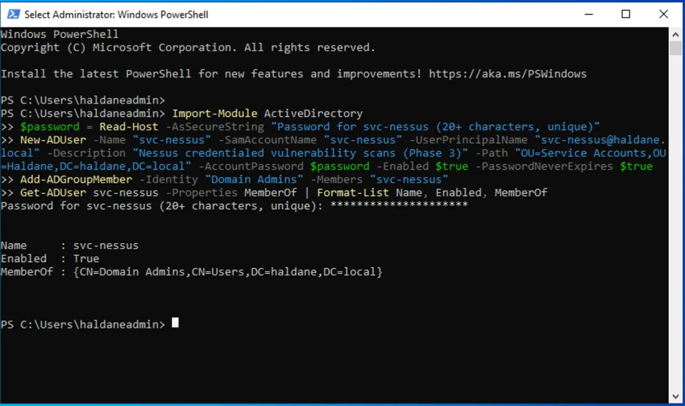

## Letting the scanner in: least privilege

A credentialed scan needs SMB (445), RPC (135) and WMI on each target, which
Windows Firewall blocks by default. Rather than opening them to the whole
network, a Group Policy, "Haldane - Vulnerability scanner access", allows them
only from KALI01 (10.10.2.4). It is linked to the domain, so DC01 and WS01
both receive it, and any future machine would too.

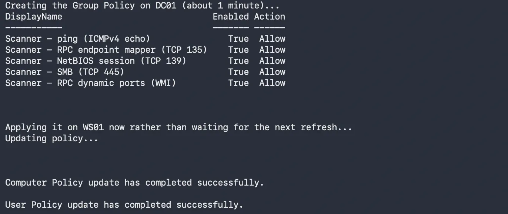

Port test from KALI01 ([`check-scan-ports.sh`](../scripts/check-scan-ports.sh)),
before and after. Before: DC01 was switched off and WS01 only answered on RDP.
After: DC01 answers on its domain controller ports (DNS 53, Kerberos 88,
LDAP 389) and both servers answer on RPC (135), NetBIOS (139) and SMB (445).
WS01 correctly has no DNS, Kerberos or LDAP: it isn't a domain controller.

| Before | After |
| --- | --- |
| 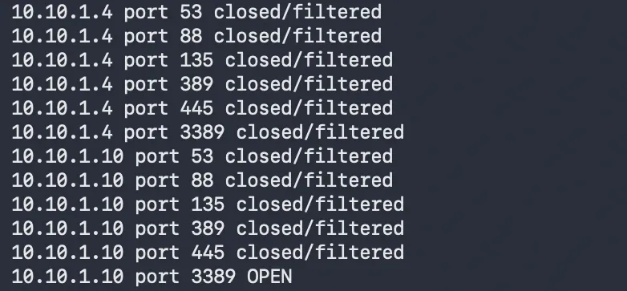 | 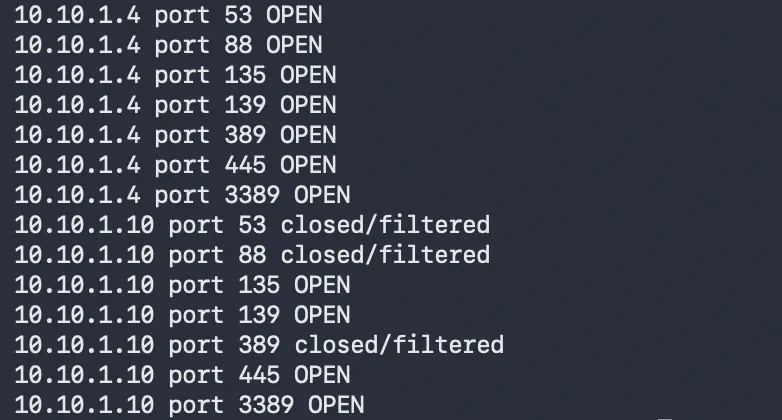 |

## Problems and fixes

| Problem | Cause | Fix |
| --- | --- | --- |
| Kali deployment failed: "VM size only supports x64, but an image with Arm64 was given" | The script picked the newest Kali image, which was the arm64 build | `deploy-attacker.sh` now ignores arm64 images |
| Remote Desktop username came through as `HALDANE\#` | zsh doesn't treat `#` as a comment in pasted commands, so a note after the command became an argument | `connect.sh` ignores a `#` argument; commands are pasted without notes |
| `install-nessus.sh` failed: `curl: command not found` | The Azure Kali image is a minimal install | The script installs curl first if it's missing |
| First scan finished in 4 minutes with 0 hosts | DC01 had been shut down from inside Windows ("VM stopped", which still bills), and WS01 doesn't answer ping, so Nessus treated both as offline. A port test from Kali showed only WS01's RDP port reachable | Started DC01 with `az vm start`; lab VMs are only ever stopped with `stop-lab.sh` (deallocate) |
| WS01's SMB (445) and RPC (135) ports blocked from Kali | Windows Firewall blocks remote management by default | A Group Policy opens them to KALI01 (10.10.2.4) only ([`08-allow-scanner.ps1`](../scripts/windows/08-allow-scanner.ps1)) |
