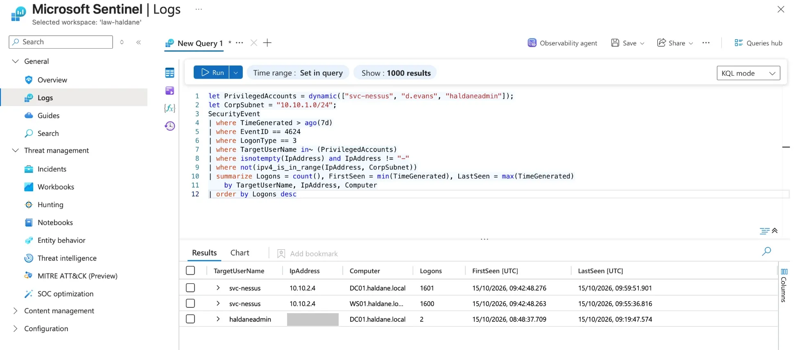
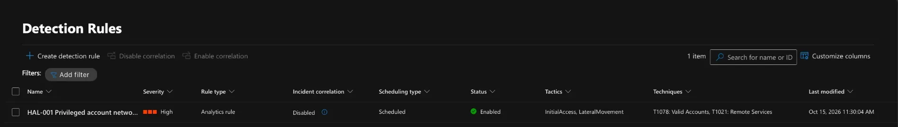

# Phase 4: Detection engineering

> **In progress.** Rules are written in KQL, stored in [`detections/`](../detections),
> tested against real lab data, then deployed as scheduled analytics rules.

## HAL-001: Privileged account network logon from outside the corporate subnet

[`detections/HAL-001-privileged-logon-from-outside-corp.kql`](../detections/HAL-001-privileged-logon-from-outside-corp.kql)

**Why:** in Phase 3, the credentialed scanner signed in as a Domain Admin
thousands of times from the attacker subnet, and Microsoft Defender raised no
alert. An attacker using a stolen admin password would look the same.

**Logic:** successful (4624) network (type 3) logons by a privileged account
from an IP outside 10.10.1.0/24.

**MITRE ATT&CK:** T1078.002 Valid Accounts: Domain Accounts;
T1021.002 Remote Services: SMB/Windows Admin Shares.

**First run against 7 days of lab data:**

| Result | Verdict |
| --- | --- |
| `svc-nessus` from 10.10.2.4 (KALI01), ~1,600 logons on each server | **True positive, expected:** the approved Phase 3 re-scan. The rule would have caught the activity Defender missed. |
| `haldaneadmin` from a public IP, 2 logons on DC01 | **True positive, benign:** the lab admin's own Remote Desktop session through Just-in-Time access. A Domain Admin logging in from the internet is worth an alert in a real company; here it is expected and explained. |

**Deployed as code:** [`infra/detections.bicep`](../infra/detections.bicep) loads the
`.kql` file into a scheduled analytics rule ([`deploy-detections.sh`](../scripts/deploy-detections.sh)):
hourly, High severity, account/IP/host entity mapping, incidents grouped when
the same entities repeat within 5 hours.

*Query written with AI assistance; tested and reviewed against lab data.*
