# Phase 4: Detection engineering

> **In progress.** Rules are written in KQL, stored in [`detections/`](../detections),
> tested against real lab data, then deployed as scheduled analytics rules.

## HAL-001: Privileged account network logon from outside the corporate subnet

[`detections/HAL-001-privileged-logon-from-outside-corp.kql`](../detections/HAL-001-privileged-logon-from-outside-corp.kql)

**Why:** in Phase 3, the credentialed scanner signed in as a Domain Admin
thousands of times from the attacker subnet, and Microsoft Defender raised no
alert. An attacker using a stolen admin password would look the same.

**Logic:** successful (4624) network (type 3) logons by a privileged account
from an IP outside 10.10.1.0/24.

**MITRE ATT&CK:** T1078.002 Valid Accounts: Domain Accounts;
T1021.002 Remote Services: SMB/Windows Admin Shares.

**First run against 7 days of lab data:**

| Result | Verdict |
| --- | --- |
| `svc-nessus` from 10.10.2.4 (KALI01), ~1,600 logons on each server | **True positive, expected:** the approved Phase 3 re-scan. The rule would have caught the activity Defender missed. |
| `haldaneadmin` from a public IP, 2 logons on DC01 | **True positive, benign:** the lab admin's own Remote Desktop session through Just-in-Time access. A Domain Admin logging in from the internet is worth an alert in a real company; here it is expected and explained. |

**Deployed as code:** [`infra/detections.bicep`](../infra/detections.bicep) loads the
`.kql` file into a scheduled analytics rule ([`deploy-detections.sh`](../scripts/deploy-detections.sh)):
hourly, High severity, account/IP/host entity mapping, incidents grouped when
the same entities repeat within 5 hours.

**Tested live:** within its first two runs the rule raised three High
incidents, each with the account, host and source IP mapped as entities:

| Incident | Entities | Cause |
| --- | --- | --- |
| 1 and 2 | `svc-nessus` on WS01 and DC01 | The Phase 3 re-scan, caught on the rule's first run |
| 3 | `haldaneadmin` on DC01, from a public IP | The lab admin's Remote Desktop session, the deliberate test |

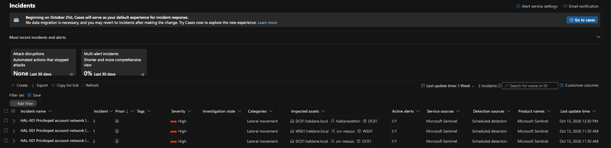
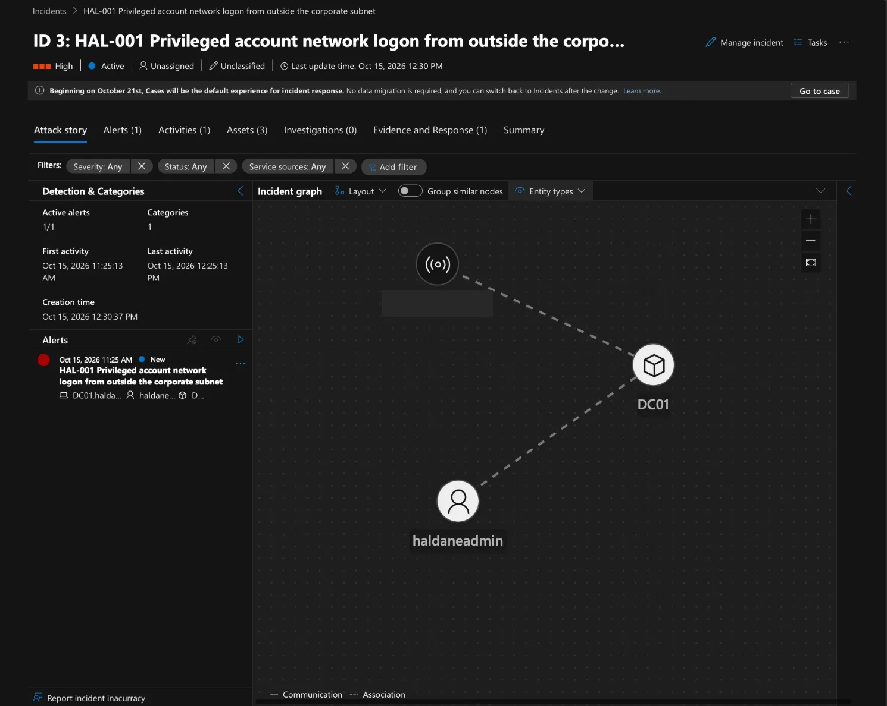

The incidents did not show at first: the Defender portal's incident list
filters on "Priority score: 15-100" by default, and new single-alert
incidents from custom rules can score lower. Removing the filter showed them.

### Tuning: approved scan windows

The scanner caused two of the three incidents. Simply excluding `svc-nessus`
would blind the rule to anyone who steals that Domain Admin account. Instead,
logons are ignored only when the **account, source IP and time** all match an
authorised scan in the `ApprovedScanWindows` watchlist
([`approved-scan-windows.csv`](../detections/watchlists/approved-scan-windows.csv)),
deployed with the rule. The same account used outside a window, or from
another address, still raises a High incident. If the watchlist is ever
missing, the rule fails safe: everything alerts.

After tuning, the same 7 days of data return only the admin's own logon; both
scanner rows are gone:

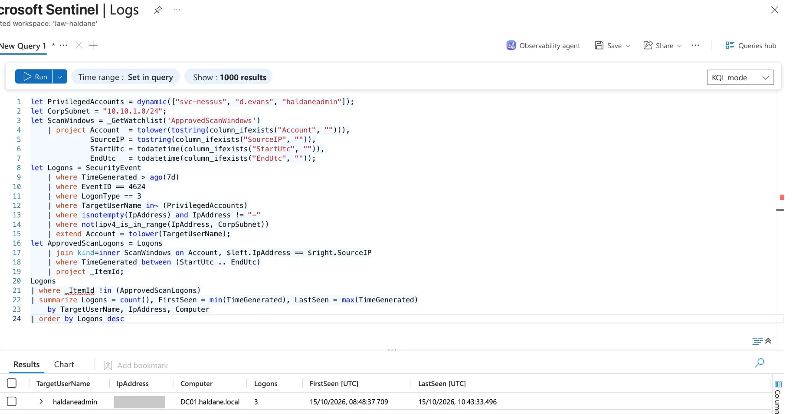

**Triage:** all three incidents were investigated and resolved as
*Informational, expected activity: Security testing* (shown in the portal as
"Benign Positive"), each with a comment recording why: the two scanner
incidents matched the approved re-scan window, and the admin logon was the
deliberate test through Just-in-Time access.

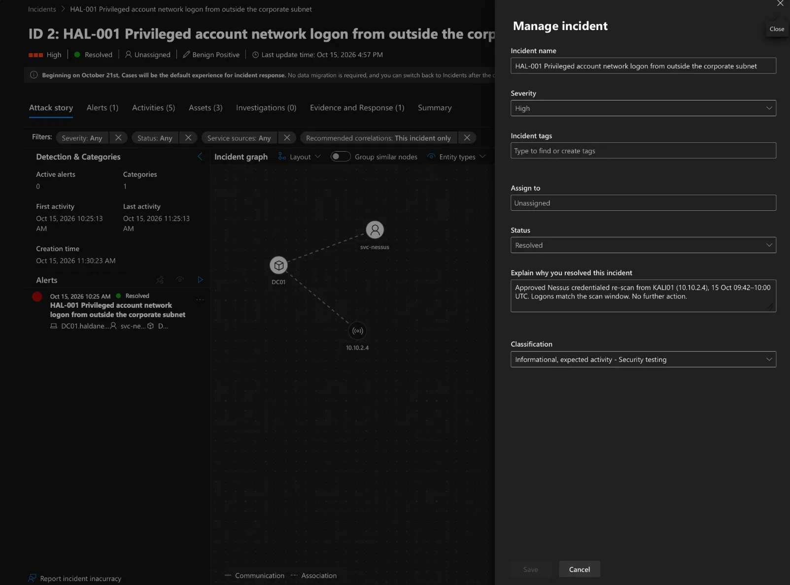

*Query written with AI assistance; tested and reviewed against lab data.*

**Still alerting by design:** each time I RDP to DC01 from home through JIT,
HAL-001 raises an incident for `haldaneadmin` from my home IP (incident 4 on
16 Oct, resolved as security testing). I have chosen not to suppress this: an
admin logon to a domain controller from the internet is exactly what the rule
is for. In a real organisation, admins would connect through Azure Bastion or
a VPN from the corporate range, so this alert would not fire.

## HAL-002: Member added to a privileged Active Directory group

**Query:** [`detections/HAL-002-member-added-to-privileged-group.kql`](../detections/HAL-002-member-added-to-privileged-group.kql)
(the KQL was written with AI assistance; I ran the test and verified the results).

**Why:** an attacker who gets admin rights once will often add an account they
control to Domain Admins so they can come back. In a small organisation these
groups almost never change, so every addition deserves a look.

| | |
|---|---|
| **MITRE ATT&CK** | T1098 Account Manipulation; T1078.002 Valid Accounts: Domain Accounts |
| **Data** | `SecurityEvent` from DC01: 4728 (global group), 4732 (local group), 4756 (universal group) |
| **Groups watched** | Domain Admins, Administrators, Enterprise Admins, Schema Admins |
| **Severity** | High |
| **Runs** | Every hour, over the last hour; one incident per change |

A trap worth knowing: in these events `TargetUserName` is the **group**, not a
person. The account that was added is `MemberName` (`MemberSid`) and the
person who made the change is `SubjectUserName`.

**Test:** on DC01 I created a disabled test account, `hal002.test`, added it to
Domain Admins in Active Directory Users and Computers, then removed it.

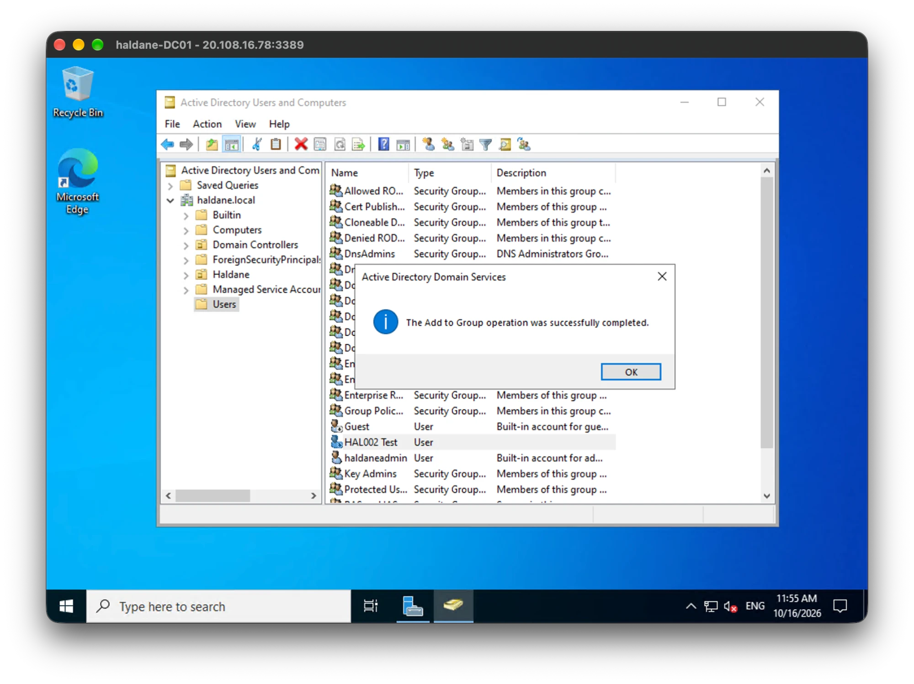

The query found exactly that change: event 4728, Domain Admins,
`CN=HAL002 Test`, added by `haldaneadmin`.

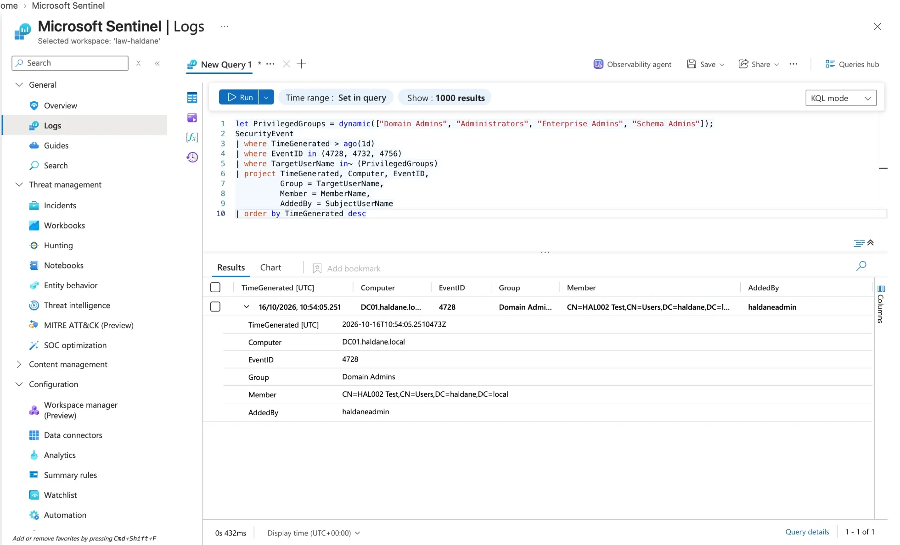

After deploying the rule, its first run picked up the same test and raised
incident 5 in Microsoft Defender:

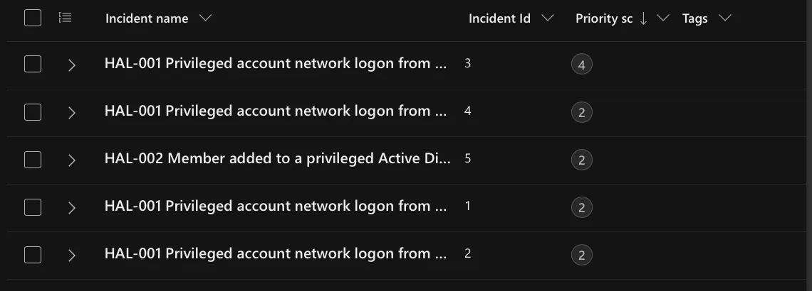

The incident linked DC01 and both accounts (the one added and the one who
added it). It was resolved as *Informational, expected activity – Security
testing*, and the test account was then deleted.

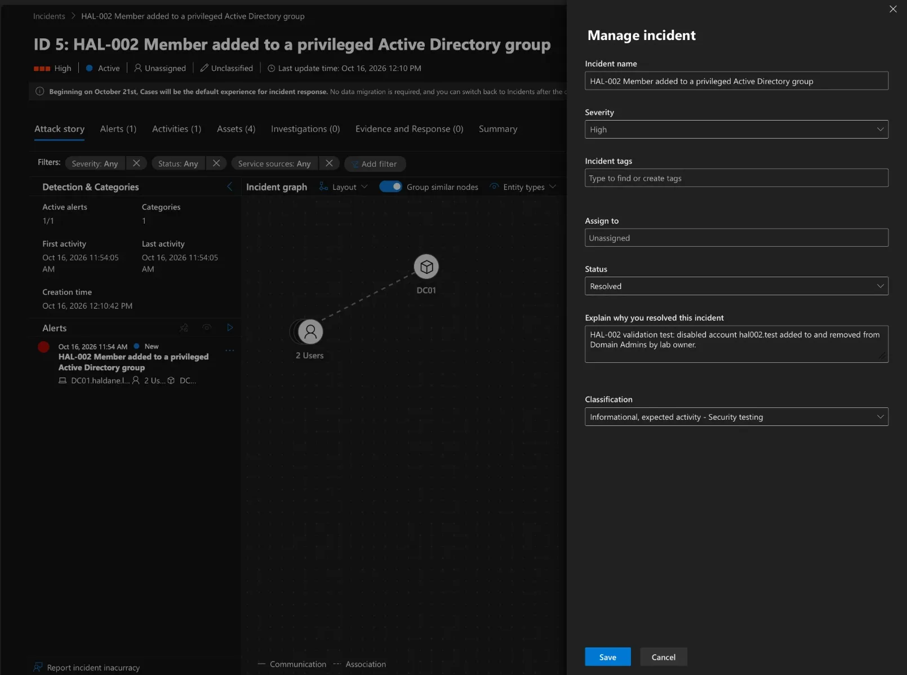

## HAL-003: Encoded PowerShell command

**Query:** [`detections/HAL-003-encoded-powershell.kql`](../detections/HAL-003-encoded-powershell.kql)
(the KQL was written with AI assistance; I ran the baseline, the test and verified the results).

**Why:** attackers pass PowerShell commands as base64 with `-EncodedCommand`
so that people and simple keyword searches can't read them. PowerShell also
accepts short forms (`-e`, `-ec`, `-enc` …), so the rule uses a regex that
matches every abbreviation but not `-ExecutionPolicy`, which also starts
with `-e`.

| | |
|---|---|
| **MITRE ATT&CK** | T1059.001 PowerShell; T1027 Obfuscated Files or Information |
| **Data** | `DeviceProcessEvents` from Microsoft Defender for Endpoint (first rule using MDE data) |
| **Severity** | Medium |
| **Runs** | Every hour, over the last 2 hours of event time but only events that arrived in the last hour (handles Defender's ingestion delay); one incident per process |

### Baseline first

Before writing the rule I checked what normally runs encoded PowerShell.

1. **7 days: no results.** But the lab had been switched off for most of that
   week, so an empty result proved nothing on its own.
2. **Data check:** confirmed Defender process events were arriving from both
   servers, so the data source was healthy.

   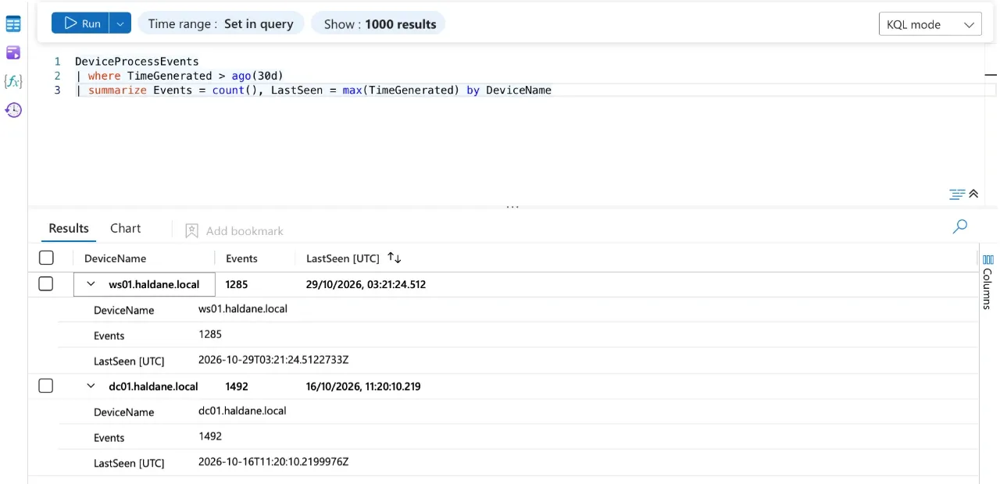

3. **30 days: 4 hits.** All were `svc-nessus`, started by `wmiprvse.exe`
   (WMI), on both servers.

   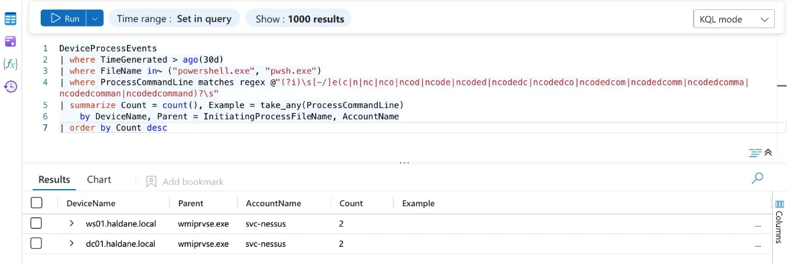

All four fall inside the two approved scan windows (8 Oct 04:55–06:00 and
15 Oct 09:35–10:10 UTC). Decoding the start of the command gives
`Add-Type -TypeDefi…`: Nessus runs some of its credentialed checks as encoded
PowerShell over WMI.

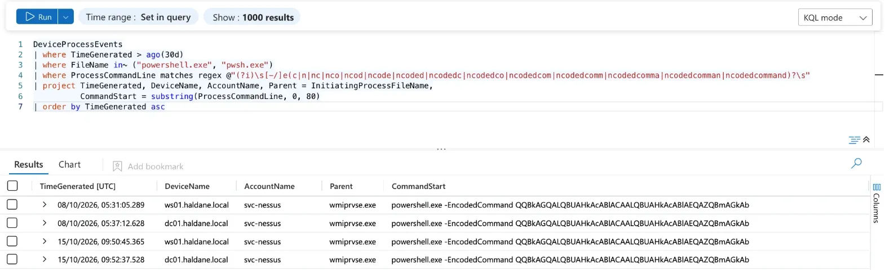

This matters: a stolen Domain Admin password used over WMI would look
exactly the same. So, as with HAL-001, the scanner is ignored **only** when
the account and time match an approved scan window, reusing the same
`ApprovedScanWindows` watchlist. One watchlist now controls scanner noise for
both rules. Process events carry no source IP, so only account and time can
be checked here.

With the watchlist exclusion, the same 30 days return nothing: the four
scanner hits are suppressed.

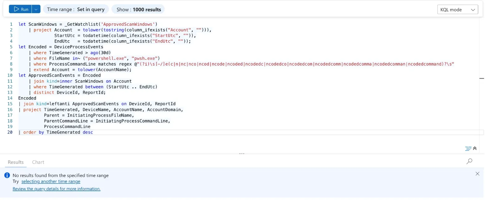

**Test:** on WS01 I ran a harmless encoded command that only prints
`HAL-003 test`.

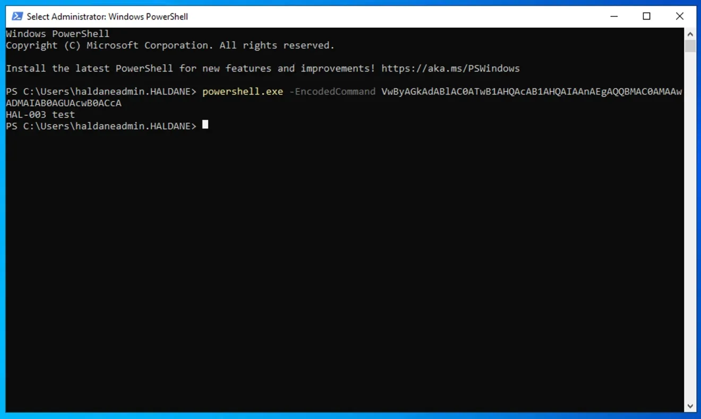

About 15 minutes later the tuned query returned exactly that one event
(03:26:55 UTC, WS01, `haldaneadmin`, parent `powershell.exe`), while the
scanner's hits stayed suppressed.

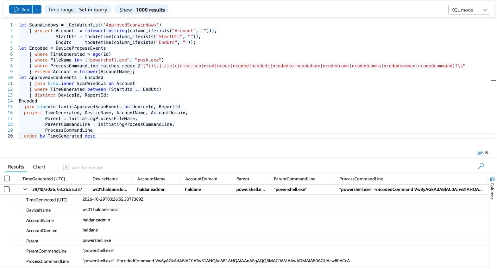

The rule raised a Medium incident (ID 6) at 03:47, about 20 minutes after the
test, linking WS01, `haldaneadmin` and the full encoded command line. It was
resolved as *Informational, expected activity – Security testing*.

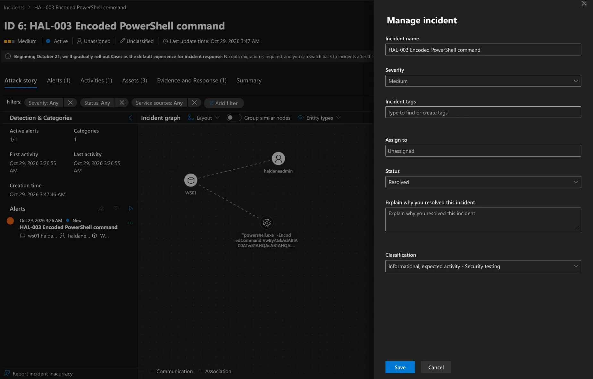

## HAL-004: Many failed logons followed by a successful logon

**Query:** [`detections/HAL-004-failed-logons-then-success.kql`](../detections/HAL-004-failed-logons-then-success.kql)
(written with AI assistance; baseline and testing by me).

**Why:** password guessing produces a burst of failed logons for one account.
Failures on their own are mostly typos and expired passwords; a burst
**followed by a success** for the same account on the same machine means the
guessing may have worked.

| | |
|---|---|
| **MITRE ATT&CK** | T1110.001 Brute Force: Password Guessing |
| **Data** | `SecurityEvent` 4625 (failed logon) then 4624 (successful logon, types 2/3/10) |
| **Threshold** | 10 or more failures for one account on one machine, then a success within 30 minutes of the last failure |
| **Severity** | High |
| **Testing** | In Phase 6 (purple-team exercise), from KALI01 |

**Baseline (30 days):** only 7 failed logons in total, never more than one
per account per hour, so a threshold of 10 leaves plenty of headroom.

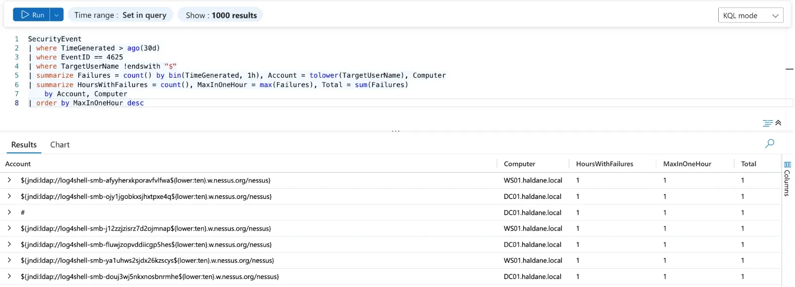

Six of the seven "accounts" are not accounts at all: they are
`${jndi:ldap://log4shell-smb-…w.nessus.org/nessus}` strings. During the
Phase 3 scans Nessus put Log4Shell (CVE-2021-44228) test strings into the
SMB **username** field, to see whether anything that logs failed logons
passes them to a vulnerable Java logging library, which would then call
back to Tenable's server. The seventh, `#`, is my own mistake from Phase 3
(the `HALDANE\#` username typed into the RDP prompt). Lesson: the
username field of a failed logon is attacker-controlled text and must be
treated as untrusted input.

**Known gaps** (for Phase 7): Kerberos password failures on the DC are logged
as 4771, not 4625, and password spraying (a few attempts against many
accounts) stays under a per-account threshold.

## HAL-005: New service or scheduled task created from the command line

**Query:** [`detections/HAL-005-new-service-or-scheduled-task.kql`](../detections/HAL-005-new-service-or-scheduled-task.kql)
(written with AI assistance; baseline and testing by me).

**Why:** after getting in, attackers make sure they survive a reboot by
creating a Windows service or a scheduled task that runs their program.

| | |
|---|---|
| **MITRE ATT&CK** | T1543.003 Windows Service; T1053.005 Scheduled Task |
| **Data** | Two process sources combined: `DeviceProcessEvents` (Defender for Endpoint) **and** Sysmon event 1, de-duplicated. Watches `sc.exe create/config binPath=`, `schtasks.exe /create`, `New-Service` / `Register-ScheduledTask` |
| **Severity** | Medium |

Encoded PowerShell would hide the PowerShell route from this rule, but HAL-003
catches encoded PowerShell, so the two rules cover each other.

**Baseline (30 days):** nothing. No service or scheduled task was created
from the command line in normal use (the HAL-003 data check had already
shown that Defender process events were arriving), so any match is worth a
look and no exclusions are needed.

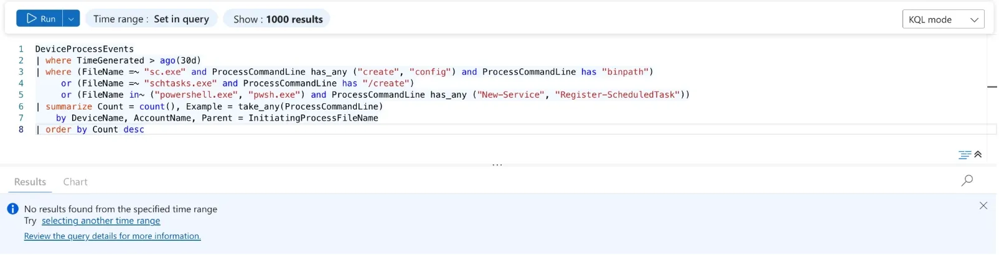

**Test:** on WS01 I created a harmless scheduled task (`HAL005-test`, which
would only print text and was never run) with `schtasks.exe`, then deleted it.

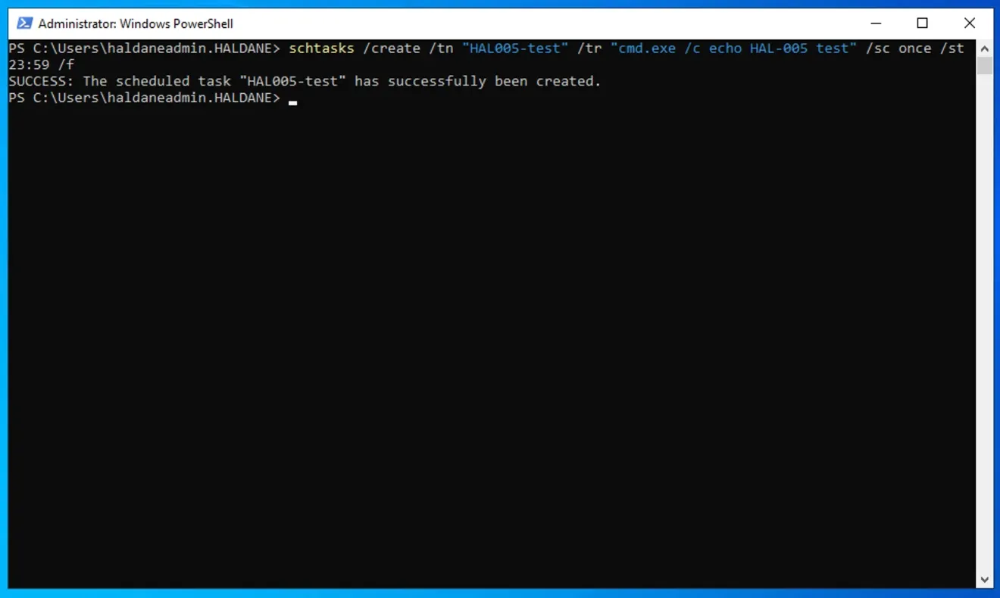

### Defender missed the event

The first version of HAL-005 read only Defender's `DeviceProcessEvents`, and
it never alerted. Checking the raw data showed why: Defender had recorded the
`schtasks /delete` at 04:14 but **not the `schtasks /create` at 04:13**, even
though WS01's data was up to date (latest event 04:55).

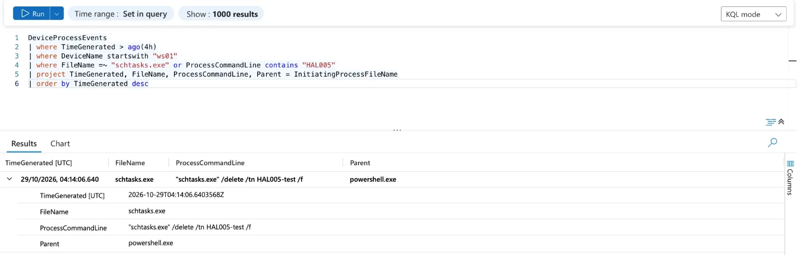

Sysmon, the second process source set up in Phase 2, had recorded **both**
(04:13:19 create, 04:14:06 delete):

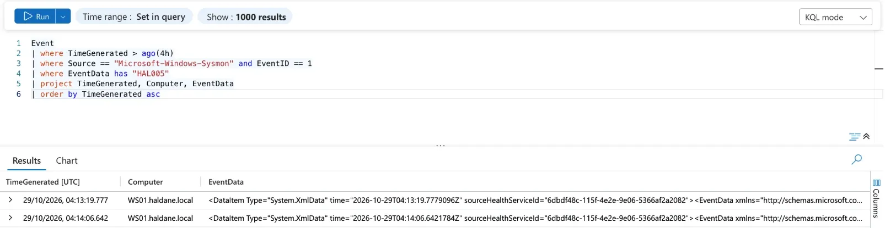

Defender for Endpoint does not promise to record every process in this
table. A rule built on one data source is blind to whatever that source
drops. HAL-005 now reads **both** sources and removes duplicates when both
saw the same process (same host, process ID and 5-minute window), and each
result says which source(s) saw it (`SeenBy`). This is the clearest lesson of
Phase 4: **test the data, not just the query**.

With both sources, the rule finds the test that Defender alone missed
(`SeenBy` = Sysmon):

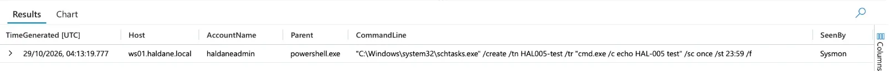

**Known gap** (for Phase 7): services or tasks created directly through the
Windows API, with no command line, are not seen. Closing it needs Defender's
`DeviceEvents` table or Windows audit events 4697/4698, neither of which is
collected yet.

## Problems and fixes

| Problem | Cause | Fix |
| --- | --- | --- |
| No incidents visible after the rule ran | The Defender portal's incident list filters on "Priority score: 15-100" by default | Removed the filter; the three incidents were there |
| Risk of HAL-003 missing late-arriving events (found while waiting for the first incident) | Defender for Endpoint events reach Sentinel 10-15 minutes after they happen. A rule that looks at only the last hour of event time can run before an event arrives and then never look at it again | The rule now looks back 2 hours of event time but only alerts on events that arrived in the last hour (`ingestion_time()`), so late events are caught once and never twice. (The first test was in fact caught: the incident was created at 03:47, about 20 minutes after the test, and I had checked too early.) |
| Deploying the tuned rule failed: "Failed to resolve scalar expression named 'Account'" | Sentinel validates a rule's query when it is saved; the new watchlist had not been indexed yet, so its columns did not exist | Read the watchlist columns with `column_ifexists()`, so the rule stays valid and fails safe (every logon alerts) if the watchlist is missing |
