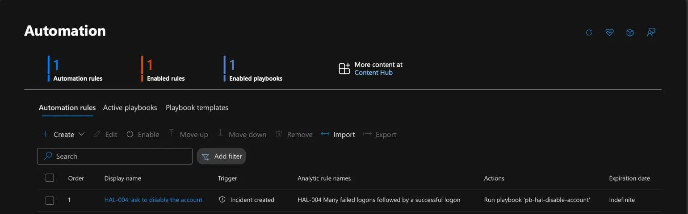
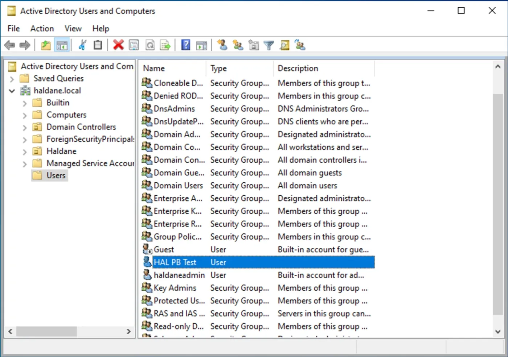
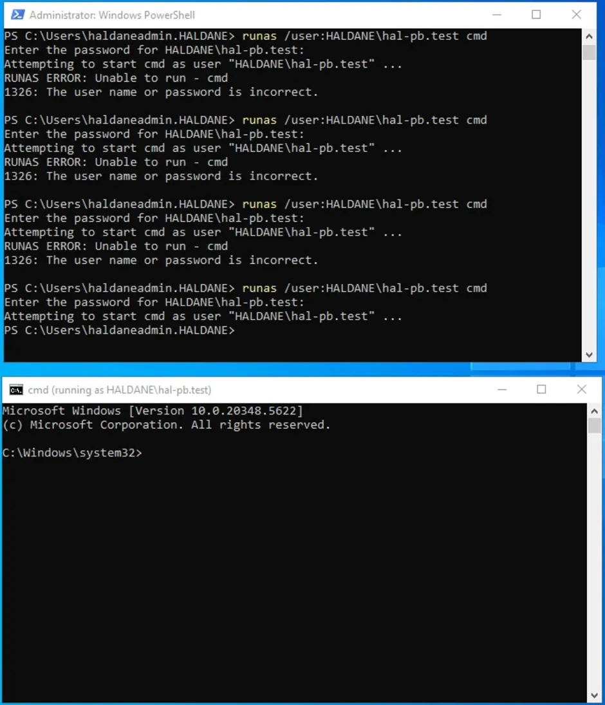
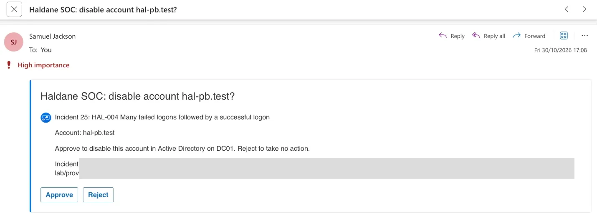
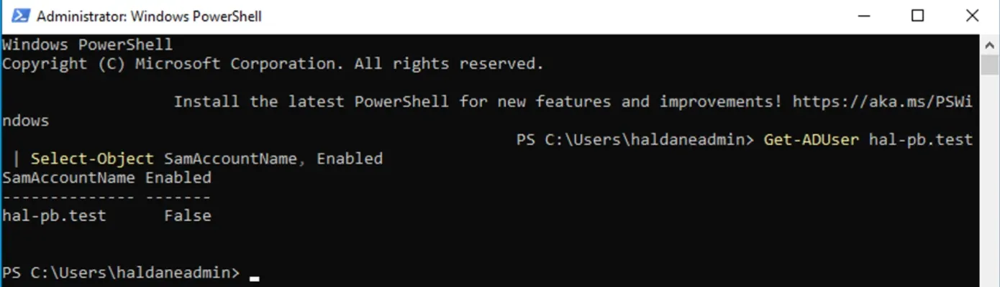
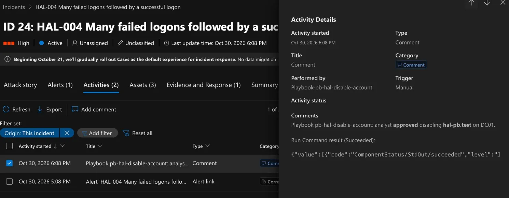

# Phase 5: Response automation

> **Done.** An approval-gated playbook: when HAL-004 (many failed logons
> followed by a success) fires, Sentinel asks a human by email whether to
> disable the account, and only acts on **Approve**. Tested end to end.

## Design

| Step | What happens | How |
|---|---|---|
| 1 | HAL-004 raises an incident | Analytics rule from Phase 4 |
| 2 | An automation rule starts the playbook | `Microsoft.SecurityInsights/automationRules` |
| 3 | The playbook reads the account from the incident | Sentinel connector, managed identity |
| 4 | The analyst gets an **Approve / Reject** email | Outlook.com connector |
| 5 | On Approve only: the account is disabled on DC01 | Azure Run Command, called with the playbook's managed identity |
| 6 | The outcome is written to the incident as a comment | Sentinel connector |

Everything is code: [`infra/playbook.bicep`](../infra/playbook.bicep),
deployed with [`scripts/deploy-playbook.sh`](../scripts/deploy-playbook.sh).
The playbook was written with AI assistance; I deployed, configured and
tested it.

## Safety decisions

- **A human decides.** Disabling an account can lock out a real user, so
  the playbook never acts without an explicit Approve.
- **No stored passwords.** The playbook signs in to Azure with its own
  managed identity, which can only comment on incidents (Microsoft Sentinel
  Responder) and run commands on DC01 (Virtual Machine Contributor on that
  one VM).
- **Protected accounts are refused** (`haldaneadmin`, `administrator`,
  `krbtgt`), so an attacker cannot use the playbook to lock out the admins.
- **Untrusted input is never pasted into a script.** The account name comes
  from log data, which an attacker can influence (Phase 4 showed attacker
  text in the username field). It reaches PowerShell base64-encoded and is
  checked against a strict pattern before use.

## Deployment

`deploy-playbook.sh` created the Logic App, its two connections, the role
assignments and the automation rule. The Outlook.com connection then had to
be signed in once by hand (API connection > Edit API connection >
Authorize), because a mailbox can't be signed in from code.

The automation rule runs the playbook whenever HAL-004 creates an incident:

## Test

On 30 Oct I created a fresh test account, `hal-pb.test`, on DC01, then on
WS01 entered a wrong password for it 12 times followed by the right one
(finishing at about 16:49 UTC), the same pattern as Phase 6's T3. This
should make HAL-004 fire, which should start the playbook.

HAL-004 raised **incident 25** and the playbook sent the approval request at
17:08, about 19 minutes after the test, naming the incident and the account:

I clicked **Approve**. About a minute later the account was disabled on DC01
(`Enabled: False`), done by the playbook through Azure Run Command, not by
hand:

The playbook then wrote the outcome back to the incident as a comment, with
the Run Command result (**Succeeded**). The playbook had waited for the
approval and only acted once it arrived:

### End-to-end result

| Step | Evidence | Result |
|---|---|---|
| HAL-004 fires on the test | Incident created ~19 minutes after the test | ✅ |
| Automation rule starts the playbook | Approval email at 17:08 | ✅ |
| Human approves | Approve clicked | ✅ |
| Account disabled on DC01 | `Enabled: False` | ✅ |
| Outcome recorded on the incident | Playbook comment, Run Command Succeeded | ✅ |

### What I'd point out about this design

- **It never acts on its own.** In the same test, Defender's own attack
  disruption *also* contained the test account, automatically, 20 minutes
  before my playbook asked for approval (see
  [Phase 6](06-purple-team.md#defenders-automatic-attack-disruption-contained-accounts)).
  Both approaches are valid: automatic containment is fast; approval-gated
  action is safer for anything that could lock out real users. A real team
  would decide which actions run automatically and which need a human, and
  make sure the two don't fight over the same account.
- **Least privilege for automation.** The playbook can comment on incidents
  and run commands on one VM. It has no password and no wider rights.

## Problems and fixes

Both fixes below are in [`infra/playbook.bicep`](../infra/playbook.bicep) but
were **not redeployed or retested** before the lab was torn down: a fair test
needs a fresh HAL-004 run, which wasn't worth the VM time. The run documented
above used the earlier version.

| Problem | Cause | Fix |
|---|---|---|
| The incident comment showed the raw Run Command JSON | The comment printed the whole response body | Changed in code (not yet deployed or retested): the comment shows just the command's output message (falls back to the raw body if that's missing) |
| The email said "Incident 25", but incident 25 in the Defender portal was a different incident (a HAL-001 RDP logon) | Sentinel and the Defender portal number incidents separately. The playbook quoted Sentinel's number; the portal shows Defender's | Changed in code (not yet deployed or retested): the email shows both the Defender incident ID (`providerIncidentId`) and the Sentinel number |
