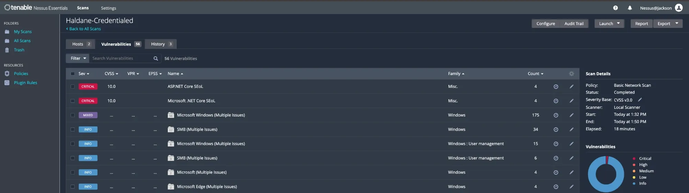
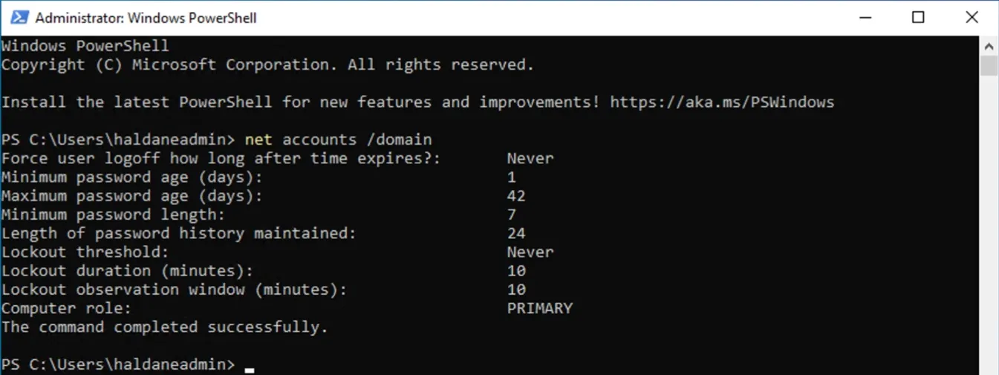
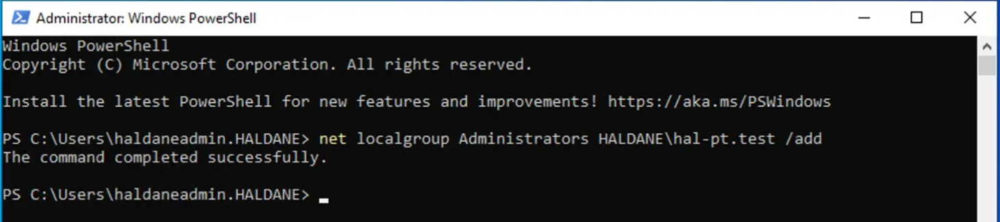
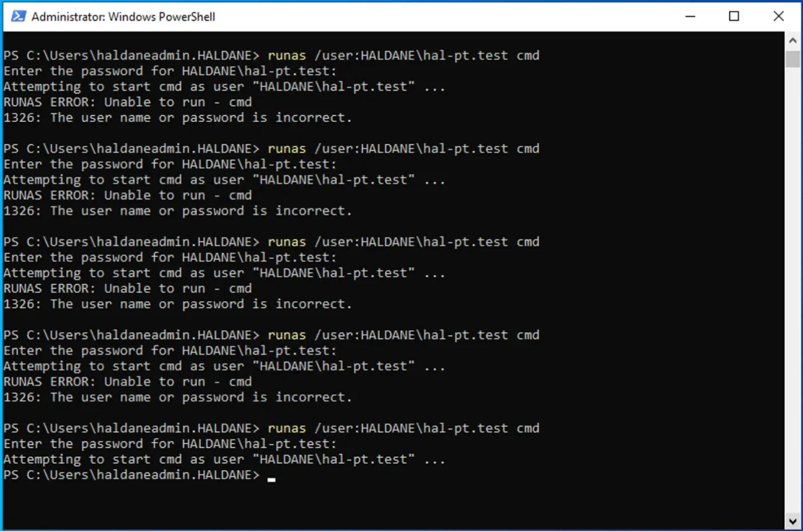
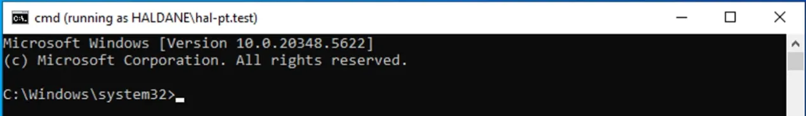
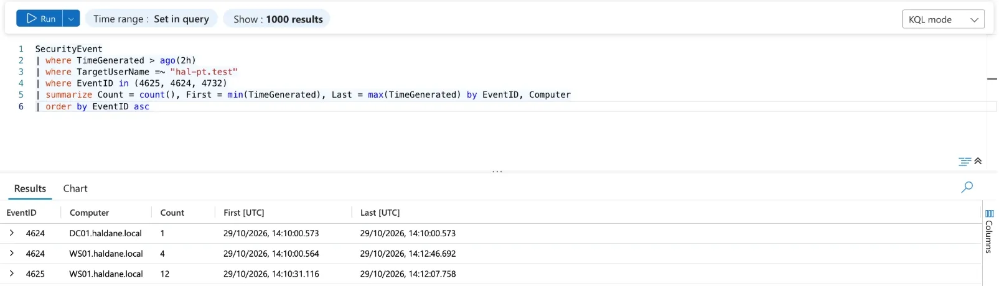

# Phase 6: Purple-team exercise

> **In progress.** Controlled tests in my own lab, each mapped to a MITRE
> ATT&CK technique, to check which activity my rules (HAL-001 to HAL-005)
> and Microsoft Defender detect, and which nothing detects.

## Ground rules

- Only my own lab (DC01, WS01, KALI01), only during a planned test window.
- A dedicated test account (`hal-pt.test`), disabled whenever it is not in use.
- Microsoft Defender stays fully on. If Defender blocks a test, that is
  recorded as a result ("prevented"), never worked around.
- Every test has a start and end time (UTC) so alerts can be matched to it.
- Every incident raised is triaged and resolved as security testing.

## Test plan

| # | ATT&CK | Test | Host | Expected detection |
|---|---|---|---|---|
| T1 | T1078 / T1059.001 | Credentialed Nessus scan **outside** any approved scan window | KALI01 → DC01, WS01 | HAL-001 (High) and HAL-003 (Medium): the watchlist must *not* suppress it |
| T2 | T1098 | Test account added to WS01's local Administrators group (event 4732, a different branch from the Phase 4 test) | WS01 | HAL-002 (High) |
| T3 | T1110.001 | Repeated wrong passwords for the test account, then the right one | WS01 | HAL-004 (High) |
| T4+ | T1059.001, T1053.005, T1543.003 and techniques with no HAL rule | Atomic Red Team tests (session 2) | WS01 | HAL-003 / HAL-005 / Defender / nothing |

## Results (detection matrix)

| # | Start–end (UTC) | HAL rule | Defender | Outcome |
|---|---|---|---|---|
| T1 | 13:32–13:50 | (pending) | (pending) | Scan completed with valid credentials on both servers |
| T2 | 14:09 | (pending) | (pending) | Test account added to WS01 local Administrators |
| T3 | 14:10–14:13 | (pending) | (pending) | Repeated wrong passwords, then success |

## T1: Credentialed scan outside an approved window

On 29 Oct I ran the same credentialed Nessus scan as in Phase 3, from
13:32 to 13:50 UTC. The `ApprovedScanWindows` watchlist only lists the two
Phase 3 windows (8 and 15 Oct), so this scan was **not** approved. If the
tuning in HAL-001 and HAL-003 is too broad, nothing will alert.

## Finding: no account lockout policy

Before the password test (T3) I checked the domain's lockout policy so the
test account would not be locked part-way through. The answer was more
important than the test: **Lockout threshold: Never**. An attacker can
guess passwords against any domain account without limit; only detection
(HAL-004) stands in the way. This goes into Phase 7 as a recommendation
(for example, lock after 10 failures for 10 minutes, which slows guessing
without making it easy for an attacker to lock everyone out).

## T2: Test account added to WS01's local Administrators group

At 14:09 UTC I added `hal-pt.test` to WS01's local **Administrators** group.
This produces event 4732 (member added to a local group), a different branch
of HAL-002 from the Phase 4 test, which used Domain Admins (4728).

A first attempt from a standard user's session (`a.patel`) was refused with
"Access is denied", as it should be: a normal user cannot make anyone an
administrator.

## T3: Repeated wrong passwords, then the right one

From 14:10 to 14:13 UTC, on WS01, I tried to start a program as
`hal-pt.test` with a wrong password over and over (`runas`), then with the
correct one. Every failure is a 4625 event on WS01, and the final success
is a 4624.

Sentinel recorded exactly what HAL-004 looks for: **12 failed logons (4625)
on WS01** between 14:10:31 and 14:12:07, then a **successful logon (4624) at
14:12:46**.

