# Phase 6: Purple-team exercise

> **Done.** Controlled tests in my own lab, each mapped to a MITRE ATT&CK
> technique, to check which activity my rules (HAL-001 to HAL-005) and
> Microsoft Defender detect, and which nothing detects.

## Summary

| What was tested | My rules | Defender built-in | Verdict |
|---|---|---|---|
| Scan account used outside an approved window (T1078, T1059.001) | ✅ HAL-001, HAL-003 | ❌ | Detected |
| Account added to local Administrators (T1098) | ✅ HAL-002 | ❌ | Detected |
| Password guessing then success (T1110.001) | ✅ HAL-004 | ❌ | Detected |
| Attack-testing toolkit downloaded (Atomic Red Team) | n/a | ✅ Blocked | Prevented |
| Discovery with built-in commands (T1033, T1087.002, T1069.002, T1018, T1482, T1082, T1016) | ❌ | ❌ | **Gap** |

**Findings carried to Phase 7**

1. **Discovery is invisible.** Nine discovery commands in under a minute
   were fully recorded by Defender and Sysmon, and nothing alerted. A rule
   for several discovery commands from one account in a short time would
   close this.
2. **No account lockout policy** (threshold: Never). Detection (HAL-004) is
   the only control against password guessing.
3. **HAL-004 shows `::1` as the IP** for local logons; map the IP only when
   it is a real remote address.
4. **HAL-002 identifies local-group additions by SID only**; resolving the
   SID to a name would speed up triage.
5. **My rules and Defender complement each other.** Defender caught none of
   the account-based tests, which are activities an admin could legitimately
   do; my rules caught none of the malware, which Defender blocked outright.

**Process lessons:** check that data is really arriving before trusting an
empty result; verify clean-up from the logs (and look for every way a step
could have been done: the test account was deleted, not disabled); confirm
unexpected IPs and accounts from evidence before closing an incident.

**Session 1 result:** all three tests were detected by the matching HAL
rule, and **none** by Microsoft Defender's built-in detections. The same
credentialed scan that raised zero alerts in Phase 3 now raises four.

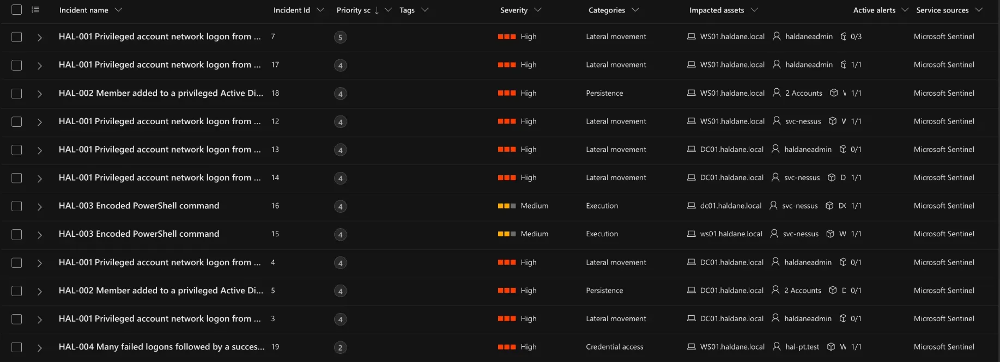

## Ground rules

- Only my own lab (DC01, WS01, KALI01), only during a planned test window.
- A dedicated test account (`hal-pt.test`), disabled whenever it is not in use.
- Microsoft Defender stays fully on. If Defender blocks a test, that is
  recorded as a result ("prevented"), never worked around.
- Every test has a start and end time (UTC) so alerts can be matched to it.
- Every incident raised is triaged and resolved as security testing.

## Test plan

| # | ATT&CK | Test | Host | Expected detection |
|---|---|---|---|---|
| T1 | T1078 / T1059.001 | Credentialed Nessus scan **outside** any approved scan window | KALI01 → DC01, WS01 | HAL-001 (High) and HAL-003 (Medium): the watchlist must *not* suppress it |
| T2 | T1098 | Test account added to WS01's local Administrators group (event 4732, a different branch from the Phase 4 test) | WS01 | HAL-002 (High) |
| T3 | T1110.001 | Repeated wrong passwords for the test account, then the right one | WS01 | HAL-004 (High) |
| T4+ | T1059.001, T1053.005, T1543.003 and techniques with no HAL rule | Atomic Red Team tests (session 2) | WS01 | HAL-003 / HAL-005 / Defender / nothing |

## Results (detection matrix)

| # | Start–end (UTC) | HAL rule | Defender | Outcome |
|---|---|---|---|---|
| T1 | 13:32–13:50 | ✅ HAL-001 ×2 (incidents 12, 14) and HAL-003 ×2 (15, 16), on both servers | ❌ No alert | **Detected by my rules only.** The watchlist did not suppress an unapproved scan |
| T2 | 14:09 | ✅ HAL-002 (incident 18) | ❌ No alert | **Detected by my rule only.** Added account identified by SID |
| T3 | 14:10–14:13 | ✅ HAL-004 (incident 19) | ❌ No alert | **Detected by my rule only.** No lockout policy, so nothing slowed the guessing |
| T4 | 30 Oct, 04:54:07–04:54:57 | ❌ No rule | ❌ No alert | **Gap.** All 9 processes recorded by both Defender and Sysmon, but nothing alerts on them |
| Toolkit | 30 Oct, 04:34–04:38 | n/a | ✅ Blocked; incident 20 (High, "Ransomware") | **Prevented by Defender.** Nothing executed |

## T1: Credentialed scan outside an approved window

On 29 Oct I ran the same credentialed Nessus scan as in Phase 3, from
13:32 to 13:50 UTC. The `ApprovedScanWindows` watchlist only lists the two
Phase 3 windows (8 and 15 Oct), so this scan was **not** approved. If the
tuning in HAL-001 and HAL-003 is too broad, nothing will alert.

## Finding: no account lockout policy

Before the password test (T3) I checked the domain's lockout policy so the
test account would not be locked part-way through. The answer was more
important than the test: **Lockout threshold: Never**. An attacker can
guess passwords against any domain account without limit; only detection
(HAL-004) stands in the way. This goes into Phase 7 as a recommendation
(for example, lock after 10 failures for 10 minutes, which slows guessing
without making it easy for an attacker to lock everyone out).

## T2: Test account added to WS01's local Administrators group

At 14:09 UTC I added `hal-pt.test` to WS01's local **Administrators** group.
This produces event 4732 (member added to a local group), a different branch
of HAL-002 from the Phase 4 test, which used Domain Admins (4728).

A first attempt from a standard user's session (`a.patel`) was refused with
"Access is denied", as it should be: a normal user cannot make anyone an
administrator.

Sentinel recorded it as event 4732 on WS01 at 14:09:16. Unlike the Domain
Admins event in Phase 4, the **member's name is blank (`-`)**: local groups
record only the account's SID (ending `-5101`). HAL-002 already maps the
added account by SID rather than by name, so the incident still identifies
it, but an analyst has to translate the SID to a name while triaging. My
first check query also missed this event because it filtered on
`TargetUserName`, which in group events is the *group*, the same trap noted
in Phase 4.

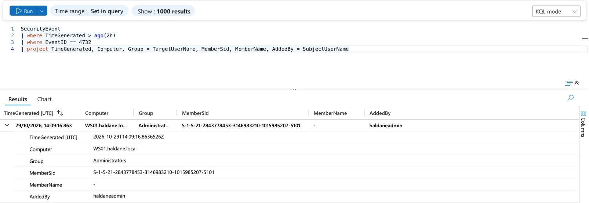

HAL-002 raised incident 18, linking WS01 and two accounts (the account added,
by SID, and `haldaneadmin`, who added it). Resolved as security testing.

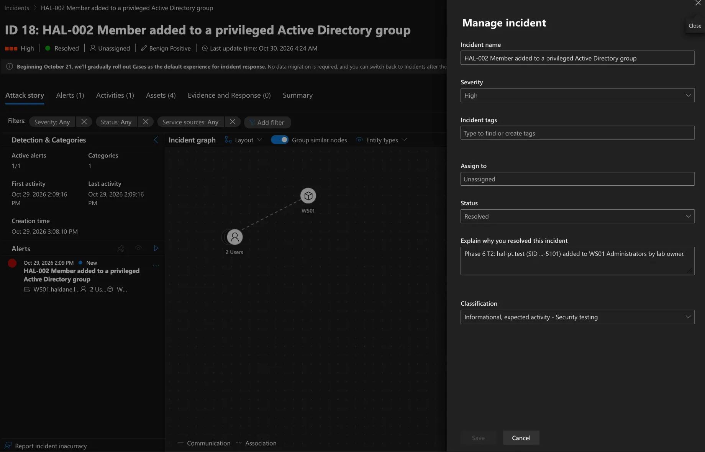

## T3: Repeated wrong passwords, then the right one

From 14:10 to 14:13 UTC, on WS01, I tried to start a program as
`hal-pt.test` with a wrong password over and over (`runas`), then with the
correct one. Every failure is a 4625 event on WS01, and the final success
is a 4624.

Sentinel recorded exactly what HAL-004 looks for: **12 failed logons (4625)
on WS01** between 14:10:31 and 14:12:07, then a **successful logon (4624) at
14:12:46**.

HAL-004 raised incident 19 for `hal-pt.test` on WS01. One thing to tune: the
IP entity is `::1` (the computer talking to itself), because `runas` signs in
locally. A local source address tells an analyst nothing, so in Phase 7 the
rule should map the IP only when it is a real remote address.

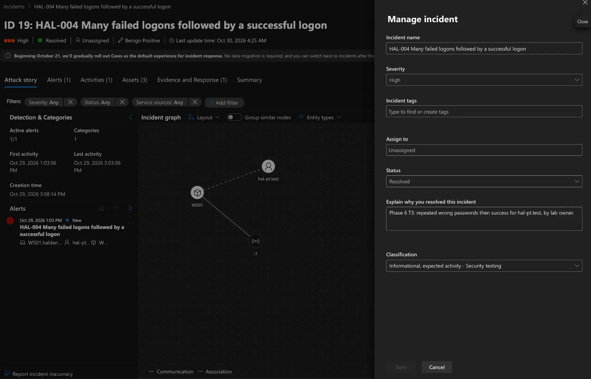

## Clean-up, checked from the logs

Rather than rely on memory, I checked the clean-up in Sentinel:

| Step | Event | Result |
|---|---|---|
| Scan account disabled after T1 | 4725 on DC01, `svc-nessus` | ✅ 14:22 |
| Test account `hal-pt.test` deleted | 4726 on DC01, by `haldaneadmin` | ✅ 14:22 |
| Test account removed from WS01 Administrators | 4733 on WS01, SID ending -5101 | ✅ 14:23 |

My first check looked only for 4725 (account **disabled**), found nothing for
the test account and wrongly concluded the clean-up had not been done. The
account had in fact been **deleted**, which is a different event (4726).
Lesson: when checking that something was done, look for every way it could
have been done, not just the one you expected.

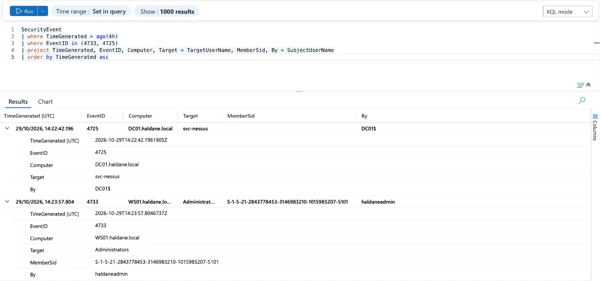

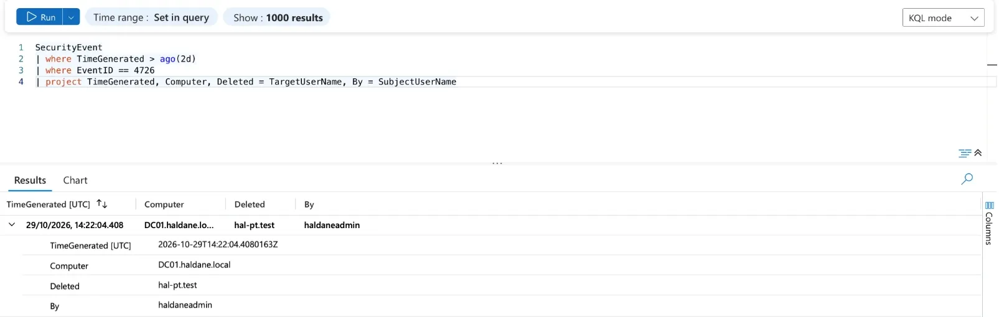

## Session 2: Atomic Red Team blocked by Defender

The plan for session 2 was to run tests from **Atomic Red Team**, an
open-source library of small tests mapped to ATT&CK techniques, on WS01.
Defender stopped it at download (30 Oct, 04:34–04:38 UTC): "Threats found",
the test library could not be moved into place, and the framework did not
load. The files Defender wanted to check include the test definitions for
T1059.001, T1558.003, T1557.001 and T1685.

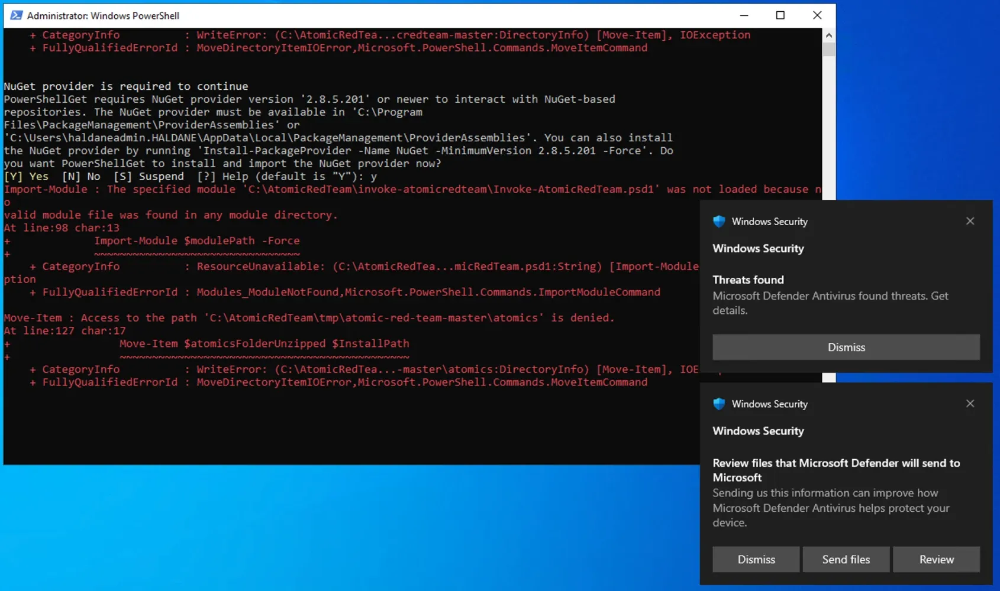

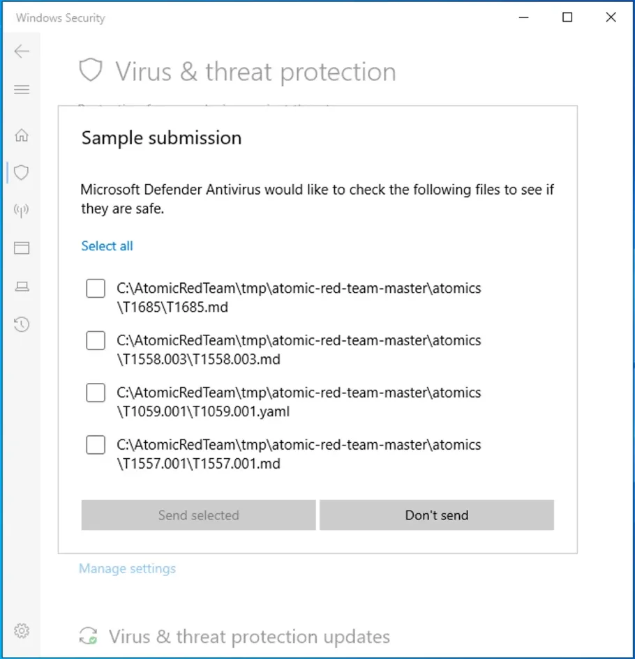

Per the ground rules I did **not** add a Defender exclusion to get it
through. Result: **prevented** by Defender's antivirus. The rule-based tests
for HAL-003 and HAL-005 had already been done directly in Phase 4, so no
coverage is lost.

Defender also raised its **own** incident, the first of the exercise not
produced by a HAL rule: **incident 20, "Multiple threat families detected
including Ransomware on one endpoint"** (High, tagged Ransomware), with 8
alerts and 11 files on WS01, among them "PowerSploit post-exploitation tool",
"'Amsipat' malware was prevented" and "Ransomware-linked threat actor
detected". All 11 files came from the Atomic Red Team download, which
contains real attack examples for testing. The title is alarming, which is
the point of triage: the evidence (file paths, timing, my own download)
shows what it actually was.

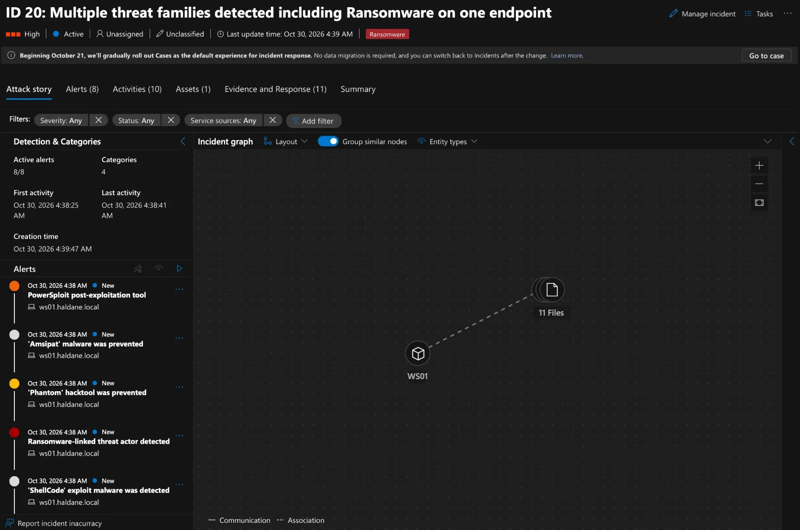

The evidence lists 11 files (attack-tool samples and test documents from the
toolkit, such as `Out-Minidump.ps1`, `phant0m.exe` and `T1685.md`). Five show
**Prevented**; six have no remediation status, matching "Remediation
incomplete" in Windows Security on WS01: Defender blocked them but could not
finish cleaning up while the installer still had the folder open.

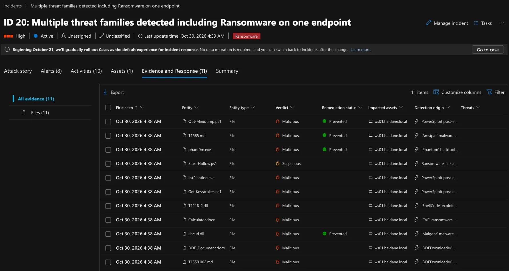

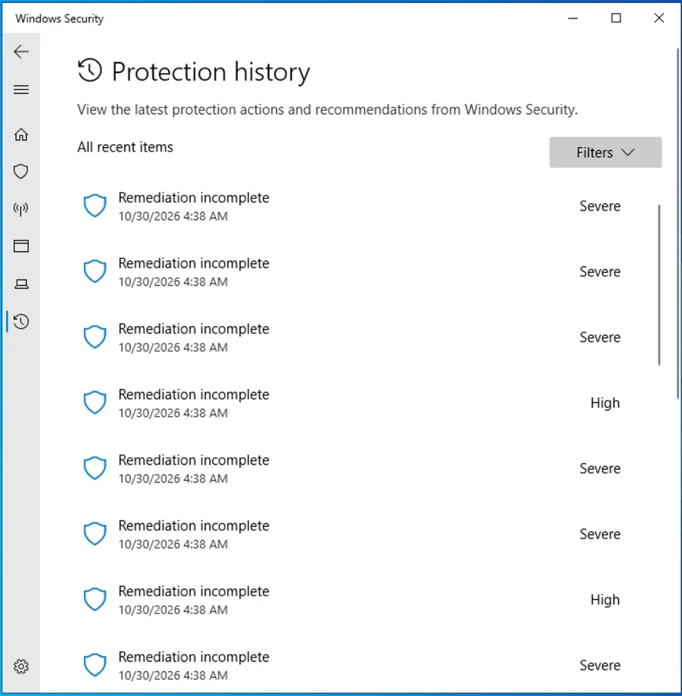

On WS01, `Get-MpThreatDetection` listed every detection with its full path:
all under `C:\AtomicRedTeam\tmp\atomic-red-team-master\atomics\`, the
download folder, and all with **ActionSuccess: True**. Nothing outside the
toolkit was involved.

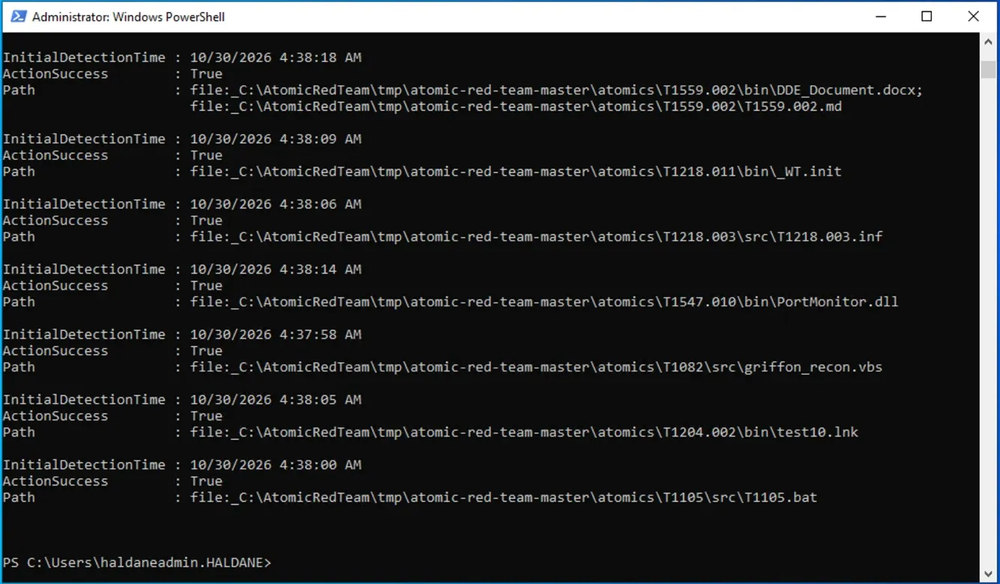

I then deleted the toolkit folder (`Test-Path` returned `False`), ran a Defender
quick scan, and listed every threat Defender had recorded. There were about
60 threat names (PowerSploit, Meterpreter, ShellCode runners, a ransomware
sample and others, all test samples from the toolkit), and **every one shows
IsActive: False and DidThreatExecute: False**: nothing is still on the
machine and nothing ever ran.

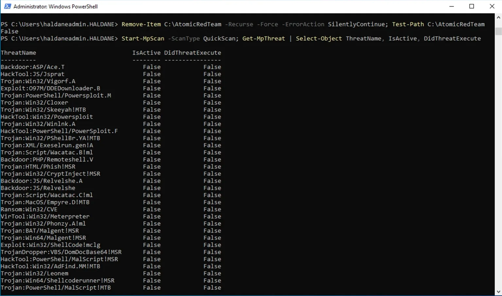

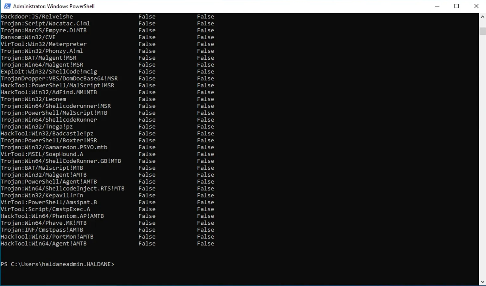

Incident 20 was then resolved as *Informational, expected activity –
Security testing*, keeping its High severity.

## T4: Discovery with built-in commands (gap test)

After getting in, attackers look around with ordinary Windows commands that
admins also use daily, so antivirus does not block them. None of the five
HAL rules covers this. On WS01, as `haldaneadmin`, I ran:

| ATT&CK | Purpose | Command |
|---|---|---|
| T1033 | Current user and groups | `whoami /all` |
| T1087.002 | Domain user accounts | `net user /domain` |
| T1069.002 | Domain Admins members | `net group "Domain Admins" /domain` |
| T1018 | Domain controllers | `nltest /dclist:haldane.local` |
| T1482 | Domain trusts | `nltest /domain_trusts` |
| T1082 | System details | `systeminfo` |
| T1016 | Network settings | `ipconfig /all` |

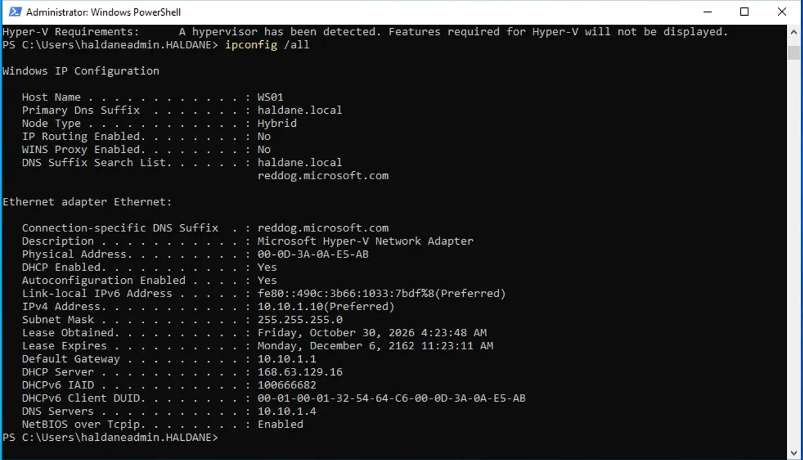

Both data sources recorded every process: the 7 commands plus the 2 `net1.exe`
helpers that `net` starts behind the scenes, 18 rows in all (9 from
Defender, 9 from Sysmon), between 04:54:07 and 04:54:57 UTC. Unlike the
HAL-005 test in Phase 4, Defender missed nothing this time.

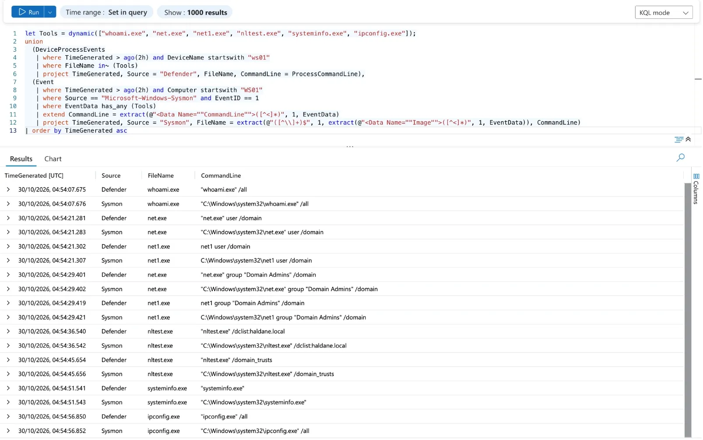
