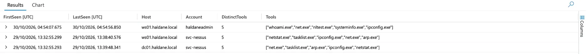
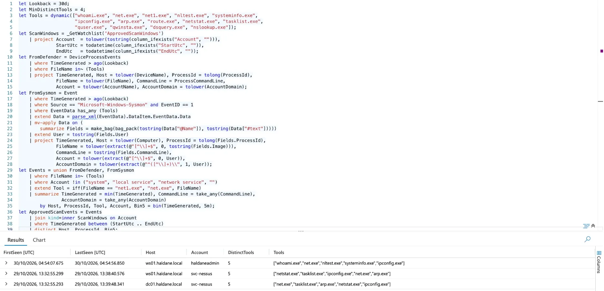
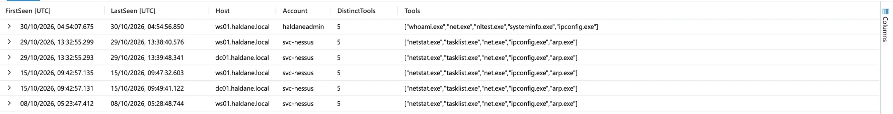

# Phase 7: Coverage and tuning

> **In progress.** What the lab now detects, mapped to MITRE ATT&CK, and the
> changes made because of what Phases 4–6 found.

## ATT&CK coverage

| Tactic | Technique | Detected by | Tested in |
|---|---|---|---|
| Initial Access, Lateral Movement | T1078 Valid Accounts | HAL-001, HAL-004 | Phase 3 re-scan; Phase 6 T1 |
| Lateral Movement | T1021.001 RDP, T1021.002 SMB | HAL-001; Defender attack disruption blocked it | Phase 4; Phase 6 |
| Persistence, Privilege Escalation | T1098 Account Manipulation | HAL-002 | Phase 4; Phase 6 T2 |
| Execution | T1059.001 PowerShell | HAL-003 | Phase 4; Phase 6 T1 |
| Defense Evasion | T1027 Obfuscated Files or Information | HAL-003 | Phase 4 |
| Credential Access | T1110.001 Password Guessing | HAL-004 (+ playbook) | Phase 6 T3; Phase 5 |
| Persistence | T1543.003 Windows Service, T1053.005 Scheduled Task | HAL-005 | Phase 4 |
| Discovery | T1033, T1087.002, T1069.002, T1018, T1482, T1082, T1016 | **HAL-006 (new, Phase 7)** | Phase 6 T4 (was a gap) |
| Execution, Credential Access (attack tools) | Known malware and hacking tools | Defender antivirus and attack disruption | Phase 6 toolkit download |

### Known gaps

| Gap | Why it is not covered | What would close it |
|---|---|---|
| Kerberos password failures (event 4771) | HAL-004 counts 4625 only | Add 4771 from the DC to HAL-004 |
| Password spraying (few tries against many accounts) | HAL-004 counts per account | A rule counting distinct accounts failing from one source |
| Services or tasks created through the Windows API | No command line to see | Collect audit events 4697/4698 or Defender's `DeviceEvents` table |
| Slow discovery spread over hours | HAL-006 looks at 10-minute windows | A daily hunting query rather than an alert |
| Credential dumping from LSASS (T1003.001) | Not tested; Defender blocks known tools | Test with a safe simulation; add a rule on LSASS access |
| Command and control, exfiltration | No network egress data in Sentinel | Azure Firewall or NSG flow logs |

## Tuning made in Phase 7

| Rule | Change | Why (evidence) |
|---|---|---|
| **HAL-006** (new) | 4+ different discovery tools from one account on one machine within 10 minutes; Defender + Sysmon; approved scan windows ignored | Phase 6 T4: nine discovery commands, recorded by both sources, nothing alerted |
| **HAL-004** | Threshold 10 → **5** failures | Baseline never above 1 per hour; the new lockout policy locks at 10, so the rule must fire first |
| **HAL-004** | IP shown only when it is a real remote address | Phase 6 T3 incident showed `::1` (local) as the IP |
| **HAL-002** | Added account's SID resolved to a name from recent 4720/4624 events; query period 14 days, alerting only on newly arrived events | Phase 6 T2: local-group events record only the SID |
| **Playbook** | Email shows Defender and Sentinel incident numbers; comment shows command output, not raw JSON | Phase 5 testing |

All rule changes were written with AI assistance and validated by me
against data already in Sentinel before deploying.

## Validating HAL-006 before deploying

Run by hand over the previous 3 days, I expected HAL-006 to find only the T4
test. It found three bursts. I checked the two unexpected ones against what
was happening at the time before accepting them:

| When | Host | Account | Tools | Verdict |
|---|---|---|---|---|
| 30 Oct 04:54 | WS01 | `haldaneadmin` | whoami, net, nltest, systeminfo, ipconfig | ✅ Phase 6 T4, the gap it was written for |
| 29 Oct 13:32–13:39 | WS01 | `svc-nessus` | netstat, tasklist, ipconfig, net, arp | ✅ Phase 6 T1: the **unapproved** credentialed scan, which Nessus runs partly as Windows commands |
| 29 Oct 13:32–13:39 | DC01 | `svc-nessus` | the same | ✅ as above |

The scanner rows are correct alerts: that scan was deliberately run outside
an approved window, so HAL-001 and HAL-003 alerted on it too. Inside an
approved window the watchlist suppresses it.

**Does the scan-window exclusion work for HAL-006?** Over 30 days the query
returned the same three rows, with nothing from the approved Phase 3 scans
(8 and 15 Oct). An empty result proves nothing unless the data was there, so
I ran a control: the same query with the exclusion line removed.

Without the exclusion, **three more `svc-nessus` rows appeared**: 15 Oct
09:42–09:49 on WS01 and DC01, and 8 Oct 05:23–05:28 on WS01, each inside its
approved window (15 Oct 09:35–10:10, 8 Oct 04:55–06:00). So the approved
scans *do* trigger HAL-006, and the watchlist is what suppresses them, while
the unapproved scan on 29 Oct still alerts.

