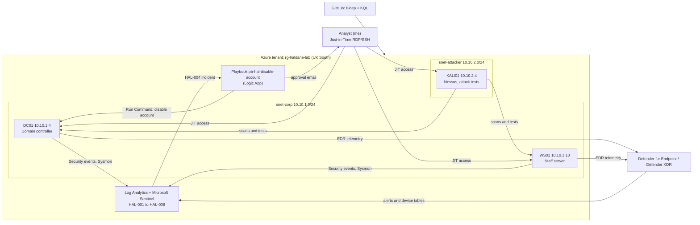

# Phase 8: Final report

> **Done.** The findings from Phases 0–7, written up as a security assessment of
> the fictional Haldane Ltd: what was built, what was found, what was fixed, and
> what I would do next.

*This report was drafted with AI assistance from my phase write-ups and
evidence; I reviewed, corrected and approved every statement in it. Every
number links back to the phase where the evidence is.*

## 1. Executive summary

Haldane Ltd is a small fictional company (a domain controller, a staff
server, six staff accounts) that I built in my own Azure tenant, entirely from
code. Over eight phases I monitored it with Microsoft Sentinel and Defender
for Endpoint, scanned it for vulnerabilities, wrote my own detection rules,
automated a response, and then attacked it in a controlled way to see what
was caught.

**Key results**

| Area | Result |
|---|---|
| Vulnerabilities | **67 → 58** findings after fixing the top three by real-world risk; **no High or Medium findings remain** ([Phase 3](03-vulnerability-management.md)) |
| Detection | **6 detection rules** written in KQL and deployed from GitHub, each one baselined and tested ([Phases 4](04-detection-engineering.md) and [7](07-coverage-and-tuning.md)) |
| Purple team | **3 of 4** account-based attacks detected by my rules and **0 of 4** by Defender's built-in detections; the fourth (discovery) was a gap, now **closed** ([Phase 6](06-purple-team.md)) |
| Malware | The attack toolkit was **blocked by Defender** before anything ran ([Phase 6](06-purple-team.md#session-2-atomic-red-team-blocked-by-defender)) |
| Response | An **approval-gated playbook** disables a suspected compromised account only after a human clicks Approve; tested end to end ([Phase 5](05-response-automation.md)) |
| Policy | Account **lockout policy added** (there was none) ([Phase 7](07-coverage-and-tuning.md#account-lockout-policy)) |

**The main finding:** my custom rules and Microsoft Defender catch
*different* things. Defender stopped known malware outright but raised no
alert for an attacker using valid accounts and built-in Windows tools, which
looks the same as an administrator doing their job. My rules caught those,
and caught no malware. A SOC needs both.

## 2. Scope and method

| | |
|---|---|
| **In scope** | DC01 (10.10.1.4), WS01 (10.10.1.10), KALI01 (10.10.2.4) attacking from a separate subnet; Azure subscription activity |
| **Out of scope** | Anything outside my own lab. No real company, user or data |
| **Period** | October 2026 |
| **Rules of engagement** | Tests only in planned windows with UTC start and end times; dedicated test accounts, deleted afterwards; Defender never disabled and no exclusions added |
| **Tools** | Azure (Bicep), Active Directory, Microsoft Sentinel, Defender for Endpoint, Sysmon, Nessus Essentials, Kali Linux, Logic Apps, KQL |

### Architecture

## 3. Findings

Ranked by risk to Haldane, not by tool score. Status is as of 31 Oct 2026.

| # | Finding | Risk | Evidence | Status |
|---|---|---|---|---|
| F1 | **No account lockout policy.** Passwords could be guessed against any domain account without limit | High | Phase 6: `Lockout threshold: Never` | ✅ Fixed: lock after 10 failures for 10 minutes; HAL-004 fires at 5 |
| F2 | **WinVerifyTrust CVE-2013-3900** on both servers, including the domain controller; known to be exploited (VPR 9.5, EPSS 44.65%) | High | Phase 3 credentialed scan | ✅ Fixed by Group Policy; gone on re-scan |
| F3 | **LLMNR enabled + SMB signing not required.** Together these allow login capture and relay | High (combined) | Phase 3 scans | ✅ Fixed by Group Policy; verified by script and re-scan |
| F4 | **Valid-account attacks raised no built-in alert.** An unapproved credentialed scan, an account added to Administrators, and password guessing were all invisible to Defender | High | Phase 3 (zero alerts), Phase 6 T1–T3 | ✅ Covered by HAL-001 to HAL-004 |
| F5 | **Discovery commands raised no alert.** Nine commands in under a minute, fully logged, nothing alerted | Medium | Phase 6 T4 | ✅ Covered by HAL-006, validated on 30 days of data |
| F6 | **Running tests as the admin account got it contained.** Defender's attack disruption treated `haldaneadmin` (the only Domain Admin) as compromised and blocked its remote access domain-wide | Medium (operational) | Phase 6, incident 23 | ✅ Released; tests now use disposable accounts |
| F7 | **Two automations acted on one account** without knowing about each other (Defender containment and my playbook) | Low | Phase 5 / Phase 6 | ⚠️ Documented; needs a decision on which actions run automatically |
| F8 | **.NET 6 runtimes out of support** (Nessus "Critical" 10.0) with nothing on the servers using them | Low in this environment | Phase 3 | ⏳ Accepted; planned change (confirm nothing depends on them, then remove) |
| F9 | **Minimum password length is 7** (Windows default) | Medium | Phase 7 | ⏳ Open: recommendation R2 |

**Where I disagreed with the scanner:** Nessus rated the .NET 6 findings
Critical and LLMNR Info. I ranked them the other way round, because LLMNR is
the first step of a common attack and nothing on these servers uses .NET 6.

## 4. Detection coverage

| Rule | Detects | ATT&CK | Proven by |
|---|---|---|---|
| HAL-001 | Privileged network logon from outside the corporate subnet | T1078, T1021 | Phase 3 re-scan; Phase 6 T1 |
| HAL-002 | Member added to a privileged group | T1098 | Phase 4; Phase 6 T2 |
| HAL-003 | Encoded PowerShell | T1059.001, T1027 | Phase 4; Phase 6 T1 |
| HAL-004 | Many failed logons then a success (+ playbook) | T1110.001 | Phase 5; Phase 6 T3 |
| HAL-005 | New service or scheduled task (Defender + Sysmon) | T1543.003, T1053.005 | Phase 4 |
| HAL-006 | Burst of discovery commands (Defender + Sysmon) | T1033, T1087, T1069, T1018, T1482, T1082, T1016 | Phase 7, against the Phase 6 T4 data |

Approved Nessus scans are excluded by a watchlist of scan windows, matched on
account **and** time, so an unapproved scan by the same account still alerts
(proven in Phase 6 T1 and the Phase 7 control test). The full map and the
known gaps are in [Phase 7](07-coverage-and-tuning.md).

## 5. Recommendations

In priority order, for a real organisation in Haldane's position.

| # | Recommendation | Closes | Effort |
|---|---|---|---|
| R1 | Decide which automatic actions (Defender attack disruption, playbooks) may act without a human, and make sure the only admin account can't be locked out of recovery: a second break-glass admin, kept out of daily use | F6, F7 | Low |
| R2 | Raise the minimum password length to 14 or use passphrases; alert on lockouts (event 4740), especially for admin accounts | F9, gap | Low |
| R3 | Count Kerberos failures (4771) in HAL-004 and add a password-spraying rule (many accounts failing from one source) | Gaps | Medium |
| R4 | Remove the unused .NET 6 runtimes once confirmed nothing depends on them | F8 | Low |
| R5 | Collect service and task creation events (4697/4698) so persistence through the Windows API is seen, not just command lines | Gap | Low |
| R6 | Add network egress logs (NSG flow logs or a firewall) to see command and control and data leaving | Gap | Medium–High (cost) |
| R7 | Safely test credential dumping (LSASS access) and write a rule for it | Gap | Medium |

## 6. Lessons learned

1. **Baseline before writing a rule.** The 30-day baselines found the
   scanner running encoded PowerShell and putting Log4Shell test strings in
   usernames, before either could become a false alarm.
2. **An empty result proves nothing until you've proved the data is there.**
   I ran a control test with the exclusion removed to prove HAL-006's
   watchlist was actually doing the suppressing.
3. **When the portal disagrees with itself, test the real effect.** The
   admin account still showed "Contained", but an RDP sign-in proved it no
   longer was.
4. **Check the evidence, not the assumption.** Several of my early readings
   were wrong (a clean-up I thought was missing had been done another way;
   an admin lockout exemption that the policy showed wasn't there; a
   validation I expected to return one row returned three). Each time the
   logs or the settings gave the real answer, and I've kept the corrections
   in the write-ups.
5. **Built-in and custom detection complement each other.** Neither alone
   would have caught everything in Phase 6.
6. **Run attack tests as a disposable account.** Using the admin account
   made Defender treat my own admin work as an attack for the rest of the
   day.

## 7. How AI was used

I used an AI assistant (Claude) throughout, as I would a senior colleague:

- **AI-drafted, then reviewed and tested by me:** the Bicep templates,
  scripts, KQL rules, the playbook, the finding ranking, and the first
  drafts of these write-ups.
- **Done by me:** building and running the lab, every portal step, running
  the scans and attacks, triaging every incident, checking every result
  against the evidence, all screenshots, and the decisions recorded here
  (for example, keeping administrator lockout enabled).
- **Where the AI was wrong:** it predicted the wrong result more than once
  (see lesson 4). Those mistakes were caught by checking the data, and the
  corrections are left visible in the write-ups.

## 8. Cost

**Total for the whole project: £28.90** (`rg-haldane-lab`, 4–31 Oct 2026,
from Azure Cost Management), about **£1 a day** on average and well inside
the £40 monthly budget.

| | |
|---|---|
| Budget | £40 per month, with alerts at 50%, 90% and 100% forecast |
| VMs running (3 VMs) | about 25p per hour |
| Everything deallocated | about £1 per day (disks, Sentinel, Defender plans) |
| Controls | VMs deallocated after every session, auto-shutdown at 23:00, Just-in-Time access, 1 GB/day ingestion cap |
